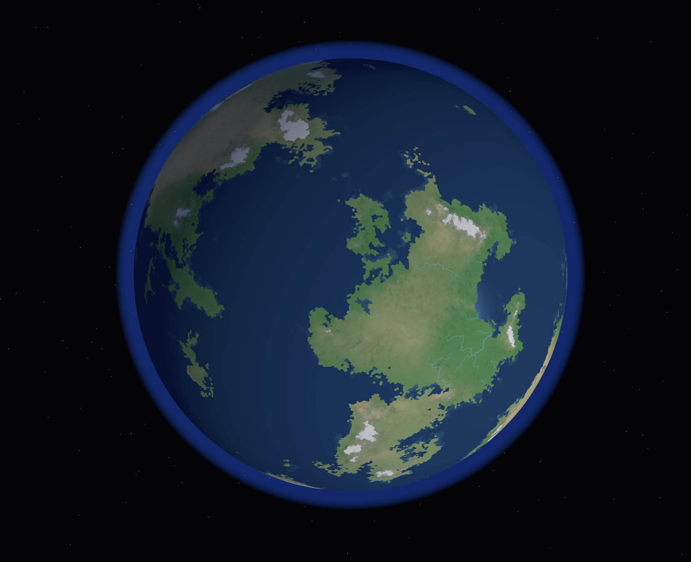

# Another Earth Generator

[English](./README.md) | [简体中文](./README.zh-CN.md)



An experimental project to generate procedural virtual planets in the browser. The same seed and parameters determine the spherical grid, tectonic plates, continents, terrain, seasonal climate, river networks, biomes, and human geography; the same spherical result can be viewed in both a 3D globe and a 2D map.

## What it can do now

- Adjust the seed, grid detail, tectonic plate and continent parameters, terrain strength, axial tilt, and temperature/precipitation parameters to regenerate the world.
- Switch between the globe and map to view satellite imagery, terrain, elevation, tectonic plates, geometric flow, monthly temperature and precipitation, winds, ocean currents, Köppen climate classification, and biomes.
- View population, market access, ethnic groups, languages, polities, and religions; overlay settlements, roads, sea routes, and rivers, and click regions to inspect their data.

The generated result is an approximate model for visualization and procedural generation, not a quantitative forecast of the Earth system. Ocean current strength is a relative value. The hydrology stage does not yet generate visible lakes, and the human geography system is a static world snapshot.

## Running locally

Requires Node.js and pnpm. In the project root directory, run:

```bash
pnpm install
pnpm dev
```

Open the local address provided in the terminal. Use `pnpm test` to run existing tests and `pnpm build` to create a production build.

## Where to start reading

Start with the [documentation index](docs/README.md), then read the [system architecture](docs/architecture.md) and [data contracts](docs/data-contracts.md). These documents are currently in Chinese and link to the implementation for details.

Core modules are grouped by responsibility: [`simulation`](src/core/simulation/) contains the generation pipeline and domain models, [`data-source`](src/core/data-source/README.md) provides raster and GeoJSON sources, [`styles`](src/core/styles/README.md) defines declarative map styles, and [`rendering`](src/core/rendering/) contains the 2D/3D renderers. The shared spherical grid remains in [`mesh`](src/core/mesh/).

The generation pipeline now includes population and settlements, transport and markets, ethnic groups and languages, polities and administration, and religions and beliefs. See the [Worker pipeline](src/core/simulation/worker/simulation.worker.ts) for the execution order.

Tech Stack: TypeScript, Vite, Svelte 5, Three.js, Tailwind CSS, Vitest. The project uses pnpm for dependency management.
