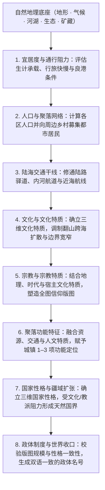
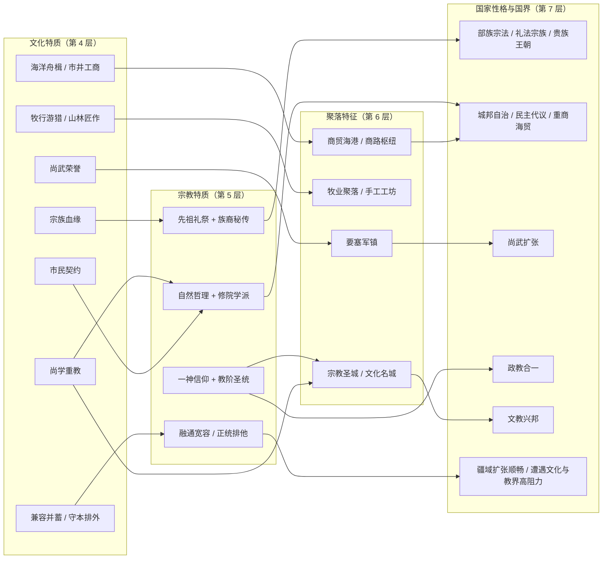
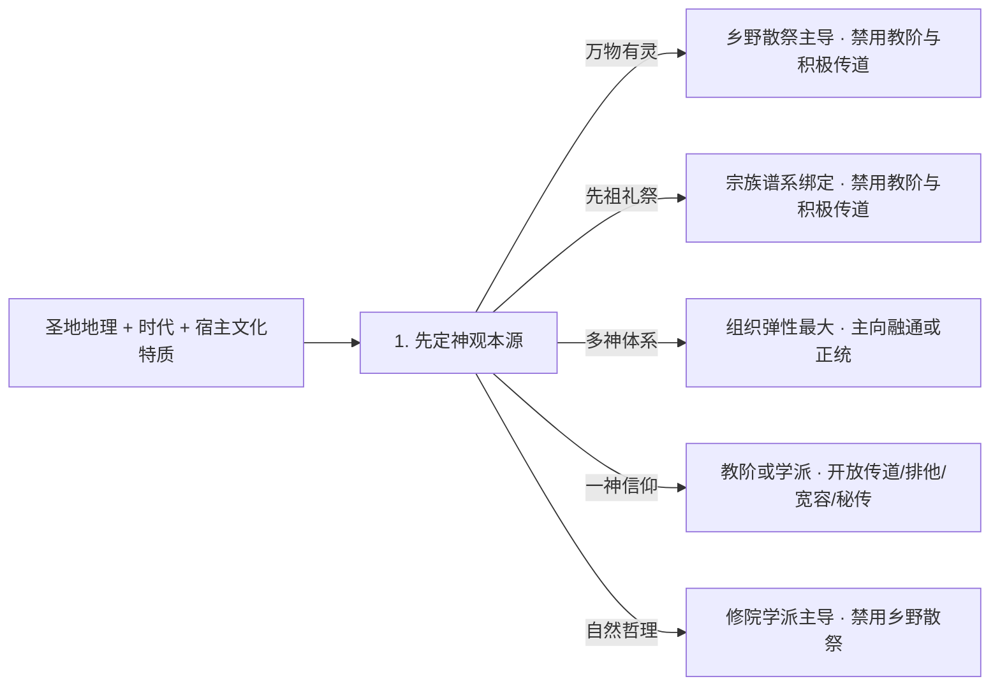
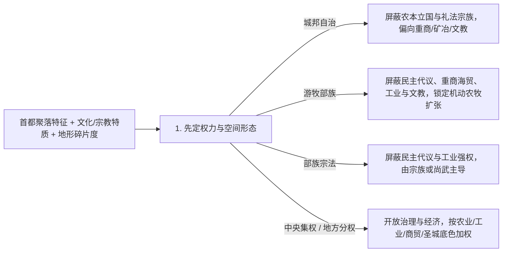
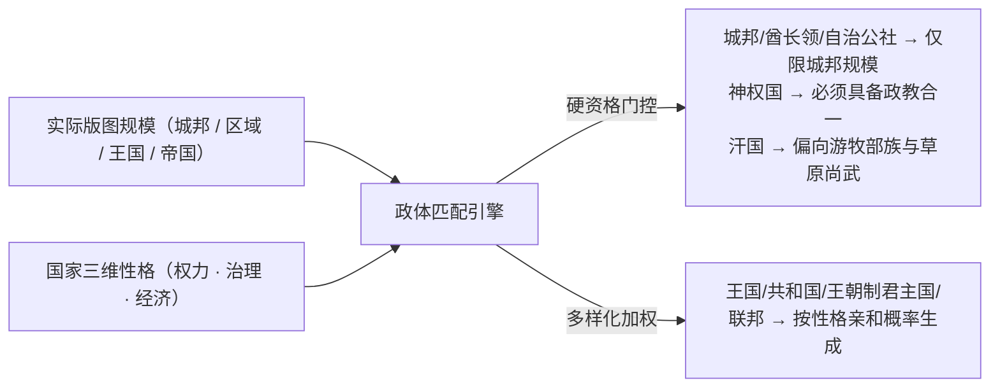

# Another Earth — 文明生成规则书

> **关于本规则书**  
> 在 Another Earth 中，城市、交通、文化、信仰与国家并不是随机撒在地图上的装饰，而是生长在山脉、河流、气候与资源之上的社会体系。  
> 本书说明一颗行星上的初始文明是如何诞生的、文化与宗教如何拥有各自的特质并相互塑造、不同参数与时代背景会带来怎样的世界格局，以及你在地图和区域详情中看到的每一项特征背后的地理与社会逻辑。

---

## 目录

1. [世界运行的基本法则](#一世界运行的基本法则)
2. [从自然到国家：四层特征与文明诞生顺序](#二从自然到国家四层特征与文明诞生顺序)
3. [创世参数与时代背景](#三创世参数与时代背景)
4. [宜居度、生计与人口分布](#四宜居度生计与人口分布)
5. [聚落、城市与交通网络](#五聚落城市与交通网络)
6. [族群、文化与文化特质（11 种）](#六族群文化与文化特质11-种)
7. [宗教、信仰与宗教特质（11 种）](#七宗教信仰与宗教特质11-种)
8. [聚落功能特征（12 种）](#八聚落功能特征12-种)
9. [国家性格与疆域版图（15 种）](#九国家性格与疆域版图15-种)
10. [国家规模、政体称号与可读成因](#十国家规模政体称号与可读成因)

---

## 一、世界运行的基本法则

1. **自然决定上限，社会决定形态**  
   地形坡度、淡水供给、温度冷暖、土壤与矿藏先确定“哪里能养活人、哪里适合建港”；农业、工业、交通与行政能力则决定人类能在多大程度上利用这些条件。
2. **四层特征，各司其职**  
   为了避免不同社会概念混为一谈，文明世界中的四类主体各自拥有独立且相互衔接的特征体系：
   * **文化特质**：这群人**如何适应环境并维系社群**（生计习俗、社群纽带、对外包容度）；
   * **宗教特质**：人们**信奉什么并如何组织信仰**（神观本源、教团组织、传教与排他性）；
   * **聚落特征**：这座城市**靠什么产业或功能立身**（农牧、矿冶、商港、圣城、要塞等）；
   * **国家性格**：政权**如何统治与向外扩张**（权力形态、治理合法性、经济立国）。
3. **万物皆有可追溯的来历（非随机组合）**  
   特征不是各维度独立掷骰子的随机拼盘，而是受**同源地理与时代底座**、**跨层因果推动**与**内部互斥约束**三重法则锁定的结果：游牧社会不会诞生城市代议共和，万物有灵也不会催生跨洲传教廷。每一座大城为什么出现在河口、为什么某种文化自带“尚武荣誉”或“海洋舟楫”、为什么国界停在某条山脉前，背后都有明确的因果链。
4. **身份独立，人口严格守恒**  
   **族群、文化、信仰、聚落、国家**是彼此独立的身份层次。同一片土地上可以共居多个民族与信仰，城市人口来自周边乡村的迁入聚集，总人口绝不会凭空多出或漏算。
5. **允许无主荒野与边疆留白**  
   国家领土代表的是政权在当时交通与行政能力下能够真正触及的控制范围。极寒冰原、无人大漠、高险绝壁和遥远孤岛，在缺乏足够投送能力时会自然保持为**无主荒野**，而不是强行把所有陆地涂满国界。
6. **物理尺度真实一致，结果确定可重现**  
   城市辐射半径、行进天数、国家面积大小都按真实的千米、平方千米和行程天数衡量，不随地图精度扭曲；只要随机种子、参数与时代设置不变，无论何时重新生成，你都会得到完全相同的星球与历史底色。

---

## 二、从自然到国家：四层特征与文明诞生顺序

文明世界沿着一条**层层递进、互为因果**的顺序逐步成型。上游诞生的特征不只是事后展示的名片，还会真实塑造下游世界的格局与边界：

### 2.1 四层特征跨层因果图谱

不同层级的特征并不是各自孤立抽签，而是沿着两条主线向下传导：**左侧是空间与产业支撑，右侧是社群、信仰与制度传导**。

---

## 三、创世参数与时代背景

在参数面板中，你可以直接选择一套**社会背景预设**，也可以微调单个滑块来做“如果……会怎样”的对照实验。

### 3.1 社会背景预设

四套预设分别对应人类历史上四种典型社会图景。**切换预设时，你的“启用开关”“人口规模倍率”与“文化多样性”会被保留**，方便你在同一个时代下单独对比人口多寡或文化繁简的影响。

| 背景预设 | 世界风貌与核心质感 |
| --- | --- |
| **农耕聚落** | 早期定居农耕与部族世界。整体人口显著稀疏，宗族血缘文化、万物有灵与乡野散祭盛行；由于交通和行政能力薄弱，大陆深处、高原与沙漠保留着大片无主荒野，国家多为紧凑的部落、领地与小邦。 |
| **城邦商贸** | 古典地中海或群岛式的商业时代。海岸港城林立、近海航线密布、城市集中度高，孕育海洋舟楫与市民契约文化、多神与哲理传统，诞生大量城邦、商人共和国与联盟，偏远内陆仍保留部族与无人区。 |
| **区域王国** | 中古至近代前夜的大陆封建与列国时代。肥沃河谷和陆路驿道支撑起少数广土王国与帝国，疆域分化明显；普世一神大教与教阶圣统崛起，山区与干旱草原边缘分布着游牧政权、要塞边疆与缓冲地带。 |
| **近代工业商贸** *(默认)* | 约 1900 年代全球化前夜。铁路港口贯通大陆与大洋，煤铁能源走廊崛起为高密度工业都市群，强大的行政与远洋投送能力让各国疆域覆盖了绝大多数宜居陆地与海岛。 |

### 3.2 独立实验参数

* **启用初始文明**：关闭后仅生成纯净的自然星球与自然资源潜力，不出现任何人口与国家。
* **人口规模倍率**（`0.1× – 4.0×`）：在当前生计条件允许的人口基数上整体缩放世界总人口。
* **文化多样性**（`0.5× – 2.0×`）：调节文化起源中心的数量与疏密程度；数值越高，世界上的语言、地名风格与民族文化圈越丰富细碎。

### 3.3 五项社会能力（决定文明“能做到什么”）

以近代工业前夜（约 1900 年）作为 `1.0×` 能力基准：

* **农业生产能力**（`0.25× – 2.0×`）：同等自然水土条件下，耕作技术能养活多少人口。
* **工业利用能力**（`0.0× – 2.0×`）：开采并结合矿物与能源、将其转化为制造中心与高人口承载力的能力。设为 `0×` 时世界没有机器工业，但依然可以采矿与经营手工工坊。
* **陆运能力**（`0.25× – 2.0×`）：决定粮食和矿产能够运送多远去养活周边城市，也决定陆路与内河旅行的快慢。
* **航海能力**（`0.0× – 2.0×`）：决定船只能否跨越海域连接港口、探索并控制远洋岛屿。设为 `0×` 时，全世界不会出现任何海上航线与跨海领土。
* **行政整合能力**（`0.0 – 1.0`）：衡量国家管理跨地形、跨文化、跨宗教及跨海领土的效率，直接影响一国能够有效统治的最大疆域半径。

### 3.4 四项社会格局（决定文明“长成什么样”）

* **聚落密度**（`0.25× – 4.0×`）：控制地图上命名城镇的数量和最小间距。
* **聚居集中度**（`0.0 – 1.0`）：控制居民向中心城市汇聚的倾向。较低时人口均匀分布在乡村；较高时城市从周边村落吸纳更多居民，形成繁华都市。
* **国家数量**（`1 – 200`）：期望在这个星球上诞生的独立政体数量。如果星球极度恶劣导致宜居城镇不够，系统会按实际可行聚落数量建造国家，不会在无人荒岛上强行充数。
* **国家面积差异**（`0.0 – 1.0`）：控制列强与小国之间的疆域分化程度。`0` 倾向于各国体量均衡，`1` 倾向于少数庞大帝国与众多中小政体共存的格局。

---

## 四、宜居度、生计与人口分布

### 4.1 地形阻力与天然障碍
世界上的每一块土地都有各自的“行进难度”：
* 平原与草地通行顺畅，而陡坡、高山和森林会拖慢行旅脚步。
* 沿主要河流两岸行进比翻山越岭容易得多。
* 无水荒漠与冰雪高原构成天然交通屏障，只有在河流穿行的绿洲地带才相对易行。

### 4.2 生存底线与资源协同
一个地区适不适合人类定居，由四道门槛共同把关：
1. **热量舒适区**：年均温在 `8°C – 25°C` 最为宜人，极寒（`-12°C` 以下）或酷热（`35°C` 以上）地带难以长期定居，永久冰原无法生存。
2. **淡水来源**：充沛降水、大河径流以及淡水湖岸都能提供水源。
3. **食物辐射范围**：平原与河谷产出的粮食、近海捕获的鱼类，可以沿着低阻力陆路运往邻近区域——**陆运能力越强，肥沃河谷能养活的周边范围越广**。
4. **矿产与燃料协同**：单独一座矿山价值有限，只有当矿产与能源矿点（或林木替代燃料）同时在可运达范围内出现，并遇上**工业利用能力**时，才会形成高吸引力的工业经济走廊。

### 4.3 两套时代人口支柱
世界人口不是靠一个固定数字强行缩放出来的，而是由两股生计力量共同支撑：
* **农牧与渔业支柱**：在农耕或古典时期起主要作用。即使完全没有工业，肥沃的大河流域和温暖海岸依然能聚集稳定的人口，但全球总人口天然维持在前工业时代的稀疏水平。
* **工业与都市支柱**：随着工业利用能力提升而逐步激活。煤铁资源带与交通枢纽能够养活远超单纯农业限度的人口，从而带来近代级别的人口爆发与百万级城市群。

---

## 五、聚落、城市与交通网络

### 5.1 城市选址与良港条件
聚落优先诞生在综合宜居度高、水土丰饶或两河交汇的地方，任何两座聚落之间都保持着合理的物理间距。如果一座沿海聚落同时拥有**平缓岸线、避风港湾地形与淡水供给**，它就会成为可供海上通航的**天然港口**。

### 5.2 乡村迁入与“44% 底线”
聚落诞生后，会像磁铁一样从周围一定半径的乡村吸引居民迁入，聚居集中度越高、城市自身条件越好，吸引范围越大。  
但为了保证世界符合常识，系统设定了严格的保护底线：**无论大城市吸引力多强，周边每一个供体地区至少保留原有 44% 的常住人口**。大都市不会把郊区吸成一片真空的无人荒原。

### 5.3 聚落等级的相对平衡
聚落分为 **首都、城市、城镇、村落** 四个等级。除了各国首都单独标记外，其余聚落并不死板地按“几百人就是村、几千人就是城”来切分，而是结合**该聚落在全世界城市中的相对排名**、**经人口倍率校正后的规模**与**最低门槛**共同决定——这样无论你把世界总人口调高还是调低，各地的核心都市依然能保留合理的等级层次。

### 5.4 陆路、内河与海路网络
所有聚落之间都会自动寻路连接成网：
* **陆路驿道**：沿陆地和内陆湖岸绕开高山深漠，连接最顺畅的邻近城镇。
* **内河航道**：当一段路径主要顺沿大河上下游行进时，通行效率显著提高，形成繁忙的沿河航运线。
* **近海航线**：只有在**航海能力 > 0** 时，具备天然良港条件的海港之间才会沿水域开辟航线。

每条线路两端城市的人口越多、行进天数越短，这条通道的**流量指数**就越高；连接线路越多、流量越大的节点，枢纽中心性也越突出。

---

## 六、族群、文化与文化特质（11 种）

### 6.1 族群与文化的层次分离
* **族群**代表更古老的血缘与谱系源流，出现年代早于文化；多个相邻文化可能出自同一支古老族群。
* **文化**代表共同的生活习俗、社群规范与地名语言风格。文化起源地数量与世界规模、**文化多样性**倍率及交通整合程度联动——交通不便的早期世界会孕育更多地方小文化圈，而高整合时代文化圈往往延展得更广。

### 6.2 文化的三维特质体系（每支文化持有 3 项，各维度 1 项）
文化不再只是一条空泛的背景名称，而是由发源地的自然风貌、聚落形态与交通网络共同塑造出三项鲜明特质，并直接决定该文化**如何向周边传播、又如何面对外来统治**：

#### 维度一：生计与空间习俗（决定文化擅长顺着什么地形扩散）
* **定居农耕**：孕育于肥沃河谷与冲积平原。在农耕平原内部凝聚力极强，但翻越山地、荒漠与跨越海洋的传播阻力较高，不易远距离迁徙。
* **海洋舟楫**：孕育于海岸或群岛良港，且具备基础航海能力。海上航线与近海跨海峡传播成本大幅降低，天然沿着海岸线与岛链铺开。
* **牧行游猎**：孕育于草原、高原或半干旱边缘且城市化较低的地区。在草原、丘陵与开阔旱地传播速度极快，几乎不跨海扩散。
* **山林匠作**：孕育于林木覆被区或矿产山地。大幅减弱森林与山地丘陵的传播阻碍，更容易在多山林地带守住独特文化，并助推当地聚落的**手工工坊**。
* **市井工商**：孕育于高城市化、高聚居度的商路枢纽或大港。不依赖乡野渗透，强烈偏好顺着陆海交通干线“点对点跳跃”传播至其他商业城镇。

#### 维度二：社群纽带与秩序（决定社会底层如何凝聚，并传递至宗教与国家）
* **宗族血缘**：在行政整合与城市化偏低的农耕或牧业核心诞生。宗亲认同深厚，更容易孕育**先祖礼祭**信仰，并强力推高下游国家形成**部族宗法**、**礼法宗族**或**贵族王朝**的几率。
* **市民契约**：在多城镇商业网络、港口或高聚居环境诞生。社会容纳多元职业与流动人口，更容易孕育**自然哲理**或**多神体系**信仰，并支撑下游形成**城邦自治**、**民主代议**或**重商海贸**政体。
* **尚武荣誉**：在险阻边疆、多聚落竞争走廊或草原机动底座中形成。明显提升当地诞生**要塞军镇**的概率，并赋予下游国家更强的**尚武扩张**倾向。
* **尚学重教**：在稳定繁荣的高人口河谷或大型中心城镇形成。提升城市发展为**文化名城**的几率，软化邻近文化边界摩擦，支撑**文教兴邦**。

#### 维度三：对外互动倾向（决定文化边界是“渐融”还是“刀切”）
* **兼容并蓄**：多见于海陆商路十字路口、贸易大港或多民族缓冲带。会**拉宽文化混合过渡带**，形成双语乃至三语并存的商业城市与边境；外来政权统治这里时面临的跨文化摩擦较低。
* **守本排外**：多见于高山深谷、偏远孤岛、强宗族地区或交通闭塞地带。文化边界锐利清晰，极难被外族稀释；**异文化国家试图吞并该地区时，必须付出更高的行政与治安阻力**。

### 6.3 文化内部的生成顺序与搭配矩阵

一支文化并非三个维度互不相干地抽签，而是**先由当地自然地理与城市化程度定下“生计与空间习俗”，再结合时代与交通条件筛选相容的“社群纽带”与“对外倾向”**。

> 图例：`★` 典型亲和（明显加权） · `○` 允许搭配 · `✕` 互斥禁止（不会同时出现）

| 生计与空间习俗 | 宗族血缘 | 市民契约 | 尚武荣誉 | 尚学重教 | 兼容并蓄 | 守本排外 |
| --- | :---: | :---: | :---: | :---: | :---: | :---: |
| **定居农耕** | ★ | ○ *(仅高城市化可用)* | ○ | ★ | ○ | ★ |
| **海洋舟楫** | ○ | ★ | ○ | ○ | ★ | ○ |
| **牧行游猎** | ★ | ✕ | ★ | ○ | ○ | ★ |
| **山林匠作** | ★ | ○ | ○ | ○ | ○ | ★ |
| **市井工商** | ✕ | ★ | ○ | ★ | ★ | ○ |

### 6.4 文化传播与自然混居
各文化从起源地沿地形阻力与陆海交通捷径向外传播。在两个文化圈交界处及大商埠，一个地区可以同时记录最多三种文化的混居比例——**多文化交汇正是孕育“文化名城”与地方自治诉求的重要土壤**。

---

## 七、宗教、信仰与宗教特质（11 种）

### 7.1 随时代演变的信仰格局
宗教起源的数量与活跃形式会响应世界的时代与整合程度：
* **早期低整合社会**（如农耕聚落）：世界倾向于诞生数量较多、地域性极强的地方信仰，传播半径受限于山川与文化圈，偏远边缘地带仍保有较高比例的民间自然传统或未归属人口。
* **高整合与发达交通社会**（如区域王国与近代）：制度化、跨区域的普世宗教或哲学体系更容易胜出，起源数量相对收敛，并能够顺着陆海交通干线跨洲越海传播。

### 7.2 宗教的三维特质体系（每个教派持有 3 项，各维度 1 项）
信仰体系由所在圣地的自然风光、时代社会条件以及**宿主文化特质**共同孕育而成：

#### 维度一：神观与精神本源（人们信奉什么）
* **万物有灵**：在低行政、低聚居的早期社会或山林泉源、高原极地诞生。高度绑定原生自然风貌，传播能力弱，在农耕时代最为常见，工业化后多退守偏远山地。
* **先祖礼祭**：最易在**宗族血缘**文化的定居农耕地区诞生。与宗亲谱系深度绑定，极少向外族传播，强烈助推下游国家的**礼法宗族**传统。
* **多神体系**：常见于海洋舟楫、商业交叉口或多城邦交汇地带。诸神并立、善于吸纳不同地方神祇，社会宽容度天然较高，易于在多文化城市中共存。
* **一神信仰**：随着行政整合或城市化提升、成文经典与统一秩序需求出现而诞生（也常见于大河秩序核心或大部族整合时期）。尊奉唯一至高权威与成文圣约，强调唯一真理性，是形成跨洲大教团与**政教合一**国家的核心引擎。
* **自然哲理**：常在**市民契约**或**尚学重教**文化主导的密集城镇带萌发。偏重宇宙规律、天文历算与人伦思辨，随书院、商道与城市网络在士人与市民间扩散。

#### 维度二：教团组织形态（信仰如何自我组织）
* **乡野散祭**：多见于万物有灵或低行政地区。没有统一的教阶总部，只随人群迁徙缓慢渗透；几乎不会催生“政教合一”政体，边缘人群常保留民间自由信仰。
* **修院学派**：常与自然哲理、尚学重教文化或山林隐修圣地伴生。以少数宗教圣城和学术中心为枢纽沿交通网点状辐射，大幅提升所在城市成为**宗教圣城**与**文化名城**的概率。
* **教阶圣统**：常与**一神信仰**、大型农业礼制或高行政整合社会结合。拥有严密的神职等级与圣地权威，具备强大的远距离传播协调力，是下游国家出现**政教合一**与**神权国**的最关键底座。

#### 维度三：传教与包容取向（决定信仰如何扩散与排他）
* **积极传道**：多见于一神信仰、教阶圣统与发达交通网络的交汇处。能够沿陆路驿道与海上航线高速远距离扩散，跨越文化与语言边界，在边缘地带快速替代松散的地方传统。
* **融通宽容**：常见于多神体系、自然哲理或**兼容并蓄**文化区。允许同一地区长期保留第二大信仰共存，并显著缓和不同信仰国家之间的边界对立。
* **正统排他**：常见于一神信仰、教阶圣统或**守本排外**文化交界带。核心信徒极难被其他宗教动摇稀释；**异教政权向该教区扩张时会遭遇显著抬升的统治阻力**，从而把国界牢牢“卡”在信仰边界上。
* **族裔秘传**：常见于宗族血缘文化与先祖礼祭。不对异族传教，信仰版图几乎与单一文化或少数核心聚落严格重合。

### 7.3 宗教内部的生成顺序与搭配矩阵

每个教派按**“先定神观本源 → 再滤教团组织 → 再定传教与包容取向”**的顺序依次确立，杜绝“万物有灵建教廷”或“先祖祭祀向异族传道”这类矛盾组合：

> 图例：`★` 典型亲和（明显加权） · `○` 允许搭配 · `✕` 互斥禁止（不会同时出现）

| 神观与精神本源 | 乡野散祭 | 修院学派 | 教阶圣统 | 积极传道 | 融通宽容 | 正统排他 | 族裔秘传 |
| --- | :---: | :---: | :---: | :---: | :---: | :---: | :---: |
| **万物有灵** | ★ | ○ | ✕ | ✕ | ★ | ✕ | ★ |
| **先祖礼祭** | ○ | ○ | ✕ | ✕ | ○ | ✕ | ★ |
| **多神体系** | ○ | ○ | ○ | ○ | ★ | ○ | ✕ |
| **一神信仰** | ✕ | ○ | ★ | ★ | ○ | ★ | ○ |
| **自然哲理** | ✕ | ★ | ✕ | ○ | ★ | ○ | ✕ |

> **开放与秩序的平衡**：例如同为**一神信仰**，搭配 `教阶圣统 + 积极传道/正统排他` 会成为跨越洲际的大一统教会，而搭配 `族裔秘传` 则能忠实呈现“圣约仅属本族”的古老一神传统；同为**多神体系**，既能包容万神殿共融，也能以城邦护城神姿态坚守正统。

国家建立后，一个国家可以有自己推崇的主流宗教，但这并不会强行抹去国民中原本存在的多元信仰与少数派群体。

---

## 八、聚落功能特征（12 种）

每座命名聚落都会根据所在地的地形、水文、矿藏、港口条件、交通枢纽地位，以及当地的**文化特质**与**宗教特质**，获得 **1–3 项功能特征**。社会分工越简单（低聚居、无工业），普通城镇越克制（通常只展示 1 项主导特征）；大城、首都和高度分工的社会最多可同时展现 3 项复合城市功能。

| 类别 | 特征名称 | 诞生依据与人文加持 | 时代演替规律 |
| --- | --- | --- | --- |
| 生产 | **农耕中心** | 周边肥沃的农业潜力、河流灌溉与平坦地形 | 贯穿各个时代；当当地高度工业化或成为超大型海港时适度退居次席 |
| 生产 | **牧业聚落** | 草原、稀树草原或灌丛覆盖、中高海拔且不宜密集农耕（**牧行游猎**文化加持） | 早期社会突出，随着高度工业化比重逐渐减弱 |
| 生产 | **手工工坊** | 森林木材、邻近矿产结合交通中心性（**山林匠作**文化加持） | 工业能力较低时活跃；当**工业能力提升后自然演替为“工业中心”** |
| 生产 | **工业中心** | 矿产与燃料协同形成的强经济机会与高交通枢纽度 | 要求具备一定工业能力（`>= 0.35`）才会诞生，是近代世界的核心引擎 |
| 生产 | **矿业城镇** | 附近分布着富集的金属矿物或能源矿藏 | 全时期存在；若同时建起大型工业体系则让位于工业中心为主导 |
| 生产 | **林木工坊** | 邻近高产出森林且并非纯农业核心区 | 全时期存在 |
| 生产 | **渔业港镇** | 位于海岸地带且具备丰富的近海渔业资源 | 全时期存在；如果同时发展为远洋海港大埠则优先体现为商贸海港 |
| 商贸 | **商贸海港** | 天然港口条件 + 真实通航的海上航线数与海运流量（**海洋舟楫**文化加持） | 要求具备基础航海能力（`>= 0.30`）且至少连有一条海上航线 |
| 商贸 | **商路枢纽** | 交通中心性突出、陆路/内河线路汇集或大河汇流处（**市井工商**文化加持） | 陆运较弱时门槛较高，只保留极少数天然大河渡口 |
| 社会 | **文化名城** | 处于或紧邻文化起源地、多文化交汇混居且人口体量靠前（**尚学重教**文化加持） | 全时期存在 |
| 社会 | **宗教圣城** | 属于宗教起源圣地，或紧邻**教阶圣统 / 修院学派**宗教核心辐射圈 | 全时期存在 |
| 战略 | **要塞军镇** | 高海拔或陡坡地形关隘、陆路咽喉通道（**尚武荣誉**文化加持） | 随行政组织能力提高而更容易形成，原始农耕期极少出现 |

---

## 九、国家性格与疆域版图（15 种）

### 9.1 国家的三维性格体系
当首都选定后，一个国家会综合首都及周边腹地的**聚落功能底色**、**当地主流文化特质与宗教特质**、人口结构与地形碎片化程度，在**三个互不冲突的维度**上形成自己的性格特征（共 15 种，每国持有 2–3 项）：

#### 维度一：权力与空间形态（必选 1 项，决定权力如何组织）
* **中央集权**：需具备较高行政整合能力；当首都在规模上明显压倒周边地方城镇、内部文化较统一且地形平坦时最易出现。这类国家扩张积极、投送半径大、擅长整合广袤领土。
* **城邦自治**：需具备一定聚居集中度；当海港商贸、商业枢纽或**市民契约**文化显著高于纯农业底座时诞生。这类国家**把陆地边界严格控制在都市圈与近郊农牧腹地之内**，不去吞并大块内陆荒原，而是把精力投入海外航线与港口据点。
* **地方分权**：当国内存在多个实力相当的地方重镇、山川阻隔较多、或多种文化共居时容易形成，对多文化边疆的包容度较高。
* **部族宗法**：仅在行政能力与城市集中度都较低的早期社会活跃，受**宗族血缘**文化强力推动，扩张半径保守，对跨文化与跨海扩张极为谨慎。
* **游牧部族**：在腹地以牧业与**牧行游猎**文化为主导、且未高度工业化时出现。擅长在平缓草原与旱地快速机动扩张，极难向海洋发展。

#### 维度二：治理与合法性取向（条件触发 0–1 项，决定国家依靠什么凝聚人心）
* **政教合一**：首都或核心腹地拥有圣城，或国内受**教阶圣统 / 正统排他 / 一神信仰**宗教深度支配时涌现。与同信仰地区的扩张顺畅无阻，面对异教边界则阻力倍增。
* **民主代议**：需要较高的行政整合与城市集中度，且以商业、文化或工业等市民经济与**市民契约**文化为主导（不与单一农耕强绑定）。
* **尚武扩张**：在战略要冲关隘、周边多强国竞争压力、冶金武装底座或**尚武荣誉**文化主导下形成。扩张速度更快、翻越山地关隘的阻力显著降低、行政投送极限更高。
* **贵族王朝**：在具备一定行政能力的稳固农耕核心、**宗族血缘**或单文化纯度较高且非高度工业化的环境下容易形成，倾向稳健陆地统治。
* **礼法宗族**：在低工业、低城市化的农耕社会与**宗族血缘 / 先祖礼祭**传统主导下活跃，极强地凝聚同文化人群，对外扩张保守。

#### 维度三：经济立国导向（必选 1 项，由当地城镇功能与文化共同塑造）
* **重商海贸** *(需航海 >= 0.30)*：沿海商港、商贸枢纽与**海洋舟楫 / 市井工商**文化领先；陆地扩张克制，**海路与远洋港口投送成本大幅降低**。
* **农本立国**：以农耕、牧业或林木腹地立国，平原推进稳健，跨海意愿较低。
* **工业强权** *(需工业 >= 0.35)*：工业中心与矿业占比领先；**陆路、河运与海路交通干线全面提速**，擅长跨越长距离获取资源。
* **矿冶工艺** *(低工业社会活跃)*：以手工工坊、采矿与**山林匠作**文化为支柱，沿陆路与内河商道稳步拓展。
* **文教兴邦**：文化名城与**尚学重教**底蕴突出，在同文化区域内极具凝聚力与扩张优势，对强行吞并异文化地区较为克制。

> **均衡而合理的概率涌现**：即使地理条件高度相似，各维度也会在符合资格的候选中按概率加权诞生，既保证地理、文化、信仰与制度之间高度自洽，也让同一片沃土有机会长出不同制度风格的邻国。

### 9.2 国家性格的生成顺序与搭配矩阵

国家性格按**“先定权力与空间形态 → 再过滤并选择治理取向（0–1 项）与经济导向”**的顺序生成，确保不出现“游牧代议制”“城邦农本立国”或“工业部落”等违和组合：

> 图例：`★` 典型亲和（明显加权） · `○` 允许搭配 · `✕` 互斥禁止（不会同时出现）

| 权力与空间形态 | 政教合一 | 民主代议 | 尚武扩张 | 贵族王朝 | 礼法宗族 | 重商海贸 | 农本立国 | 工业强权 | 矿冶工艺 | 文教兴邦 |
| --- | :---: | :---: | :---: | :---: | :---: | :---: | :---: | :---: | :---: | :---: |
| **中央集权** | ★ | ○ | ★ | ★ | ○ | ○ | ★ | ★ | ○ | ★ |
| **城邦自治** | ○ | ★ | ○ | ○ | ✕ | ★ | ✕ | ○ | ★ | ★ |
| **地方分权** | ○ | ★ | ○ | ★ | ○ | ★ | ★ | ○ | ★ | ★ |
| **部族宗法** | ○ | ✕ | ★ | ○ | ★ | ✕ | ★ | ✕ | ○ | ✕ |
| **游牧部族** | ○ | ✕ | ★ | ○ | ★ | ✕ | ★ | ✕ | ✕ | ✕ |

*(补充约束：当且仅当 **工业强权** 被选中时，会进一步屏蔽 **部族宗法 / 游牧部族 / 礼法宗族**；**政教合一** 主要随当地 **教阶圣统 / 一神信仰 / 宗教圣城** 激活，较少与无神职散祭并存。)*

### 9.3 国家如何扩张与保留“无主荒野”
各国从首都出发，沿着地形阻力、交通干线以及**沿途居民的文化开放度与宗教包容度**向外扩展有效疆域：
1. **各有各的投送极限**：每个国家拥有一条由**行政整合能力**、**自身性格**与**疆域分化度**共同决定的最大控制预算上限。
2. **城邦克制 vs 强权广土**：`城邦自治` 的陆地控制预算短促，天然停在城市外围肥沃圈；`中央集权`、`尚武扩张` 与 `工业强权` 则能把政令沿干线投送到千里之外。
3. **文化与教界的天然防守壁垒**：当扩张触及异族或异教地区时，如果当地属于**守本排外**文化或**正统排他**宗教，扩张阻力会大幅飙升；反之若当地属于**兼容并蓄**文化与**融通宽容**宗教，边界更容易平顺整合。
4. **无主边疆自然留白**：当扩张走到连续高山、无人冰原、严酷沙漠或耗尽本国投送预算时，边界就会自然停驻，不会强行向荒漠深处涂色。陆地相邻扩张不会跳过他国领土，但可以通过真实通航的陆路、内河或海路建立飞地与港口据点。
5. **两段式海洋版图**：
   * 只要拥有基础航海能力，沿海国家都会先自然整合紧邻本国海岸的近岸岛屿；
   * 拥有**海港**的国家还会根据航海能力与海权性格（如重商海贸、工业强权）派出远洋航队，沿大海向无主岛屿建立控制；而在低航海时代，远离大陆的孤岛会继续保持无人或无主状态。

---

## 十、国家规模、政体称号与可读成因

### 10.1 客观规模与一致性修正
疆域划定后，系统按国家实际拥有的**纯陆地面积**（严格排除海面与内陆湖泊）与占世界人口份额，测定国家的真实体量：
* **城邦规模**：实际陆地面积不超过约 `37,356 km²`（大约 3 个标准区域支持盘的面积）。
* **区域规模**：面积中等的地区性国家。
* **王国规模**：覆盖广袤区域的大型国家。
* **帝国规模**：领土特别广阔，且汇聚了相当比例世界人口或跨越多文化圈的超大型政权。

如果极少数情况下，一个原本具备“城邦自治”倾向的核心在周围几乎没有竞争对手的广袤平原上意外整合出了王国或帝国体量，系统会在收口阶段把它平顺修正为**地方分权**或**中央集权**，避免出现名不副实的“帝国级城邦自治”。

### 10.2 政体制度匹配与动态名称
内在性格与实际规模决定国家最终呈现的政体制度（如王国、王朝制君主国、共和国、联邦、邦联、商人共和国、城邦、神权国、汗国、酋长领、自由领地、自治公社等）：

* **硬资格约束**：真正的小型政体（如**城邦**、**酋长领**、**自由领地**、**自治公社**）严格限定只能在**城邦规模**的紧凑领土中产生；**神权国**必须具备**政教合一**性格。物理大小与制度性格各司其职，不再混淆。
* **多样化搭配**：主流国家形态（如王国、共和国、王朝制君主国）基础权重较高，且不与单一性格死板绑定——例如一个王国既可能是中央集权或贵族王朝，也可以兼容一定程度的地方分权与公民议政；而特殊政体（如商人共和国、汗国、联邦）则会随着高度吻合的海贸、游牧或分权特征大幅提高出现几率。
* **双语一致的完整国名**：国家专有名称源于首都所属文化，而政体称谓随你的界面语言自适应拼接（例如在中文下显示“维兰共和国”，切换至英文时自然呈现对应英文政体名），不把某一种语言死板写进世界本身。

### 10.3 你能在地图与详情中读到什么
* **为什么在这里建城？** —— 点击聚落可查看它的选址依据（如河道汇流、良港遮蔽或肥沃农区）以及每一项城市特征的具体支撑信号（例如邻近何种矿藏、连接多少条商路、受到哪种文化或教派加成）。
* **文化与宗教为何呈现这种脾气？** —— 点击文化或宗教即可查看它的三维特质名片（例如**海洋舟楫 · 市民契约 · 兼容并蓄**的文化，或**一神信仰 · 教阶圣统 · 积极传道**的教派），直观理解它为何能跨海远播或稳守边界。
* **为什么国家长成这样？** —— 点击任意国家或区域，可查看国家三项性格的由来（如“受当地尚武荣誉文化与周边强邻竞争影响”或“境内教阶圣统信仰强化了政教合一”），以及疆域为何在某个方向止步（如遭遇守本排外文化带、沙漠阻力或超出当时行政半径）。
* **全局可观、可比** —— 在不同时代预设和地图专题下，你能直观看到**无主荒野的消长**、城市化率与功能分布、文化与信仰版图，理解一颗虚拟行星从荒原演进至文明的完整脉络。
