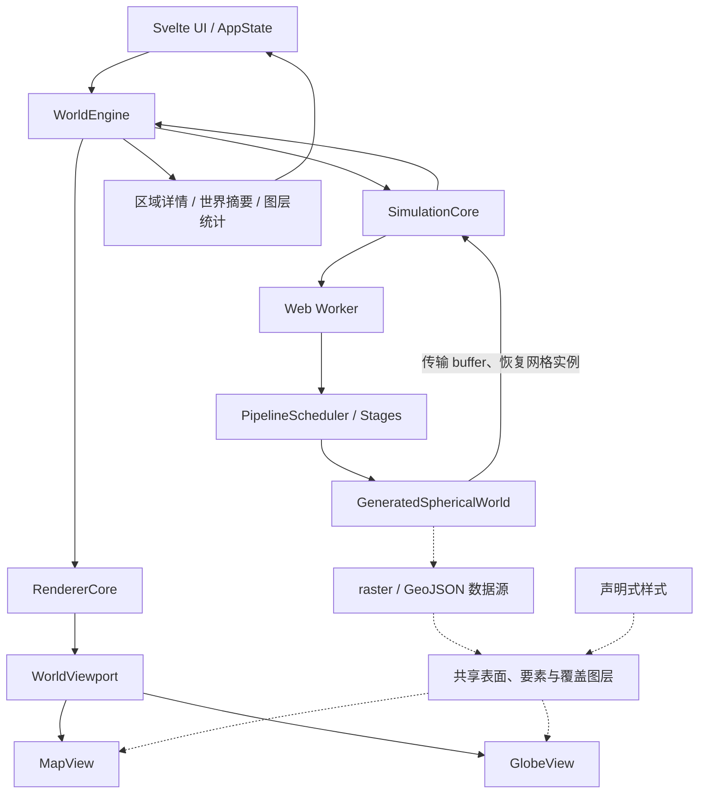
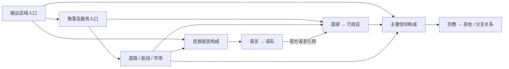
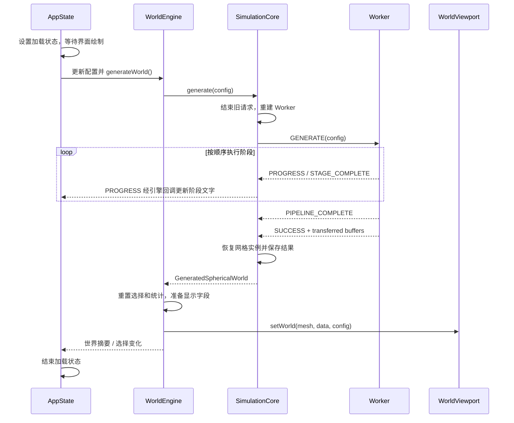

# 另一个地球生成器：系统架构说明

本文描述当前源码中的系统结构、数据流、生成机制与扩展边界，面向需要理解或修改项目的开发者。核对日期为 **2026-10-14**，依据当日工作区源码；工作区包含未提交改动，因此本文不是某个已发布版本的兼容性声明。依赖及脚本以 [package.json](../package.json) 为准。

本文中的“当前实现”指已接入运行路径的行为；“约束”指后续修改应保持的规则；“待完善”指尚未完成的工作。算法解释聚焦架构所需的机制与依赖，具体公式和参数仍以对应实现为准。

## 阅读导航

- 初次了解项目：阅读第 1～4 节，再看第 8 节的完整运行流程。
- 修改生成算法：阅读第 4～7 节，以及第 10～12 节。
- 修改地图与交互：阅读第 3、4、8、9 节。
- 新增字段、阶段或图层：先阅读第 11 节，再沿源码索引查看对应模块。
- 排查文档与实现差异：阅读第 13 节的已知局限与待完善事项。

## 1. 系统定位与边界

另一个地球生成器是一个运行于浏览器的过程化虚拟星球生成系统。系统以种子和配置为输入，在球面网格上生成构造板块、大陆、地形、季节环流、逐月气候、河网、生物群系，以及人口、聚落、交通、民族、语言、国家和宗教。地图视图与地球视图展示同一份生成结果。

当前世界生成和可视化链路在客户端执行。主线程负责界面状态、生成协调、结果查询和 WebGL 渲染；Web Worker 执行生成流水线。源码中的这一链路不依赖服务端模拟服务。

系统输出是可解释的过程化近似，适用于虚拟地理构造、交互展示与生成实验。它并未建立现实地球系统的定量预测模型，也没有逐年推进人口、战争、贸易或文化演化的历史时间轴。气候月份表示一个生成世界的年内季节变化，不是持续演化的世界时钟。

### 1.1 技术组成

| 技术或依赖 | 当前职责 |
| --- | --- |
| TypeScript | 模拟、数据契约、引擎与渲染代码 |
| Vite | 开发服务、模块构建和模块 Worker 入口处理 |
| Svelte 5 | 界面组件、参数与交互状态 |
| Three.js | 单画布 WebGL 渲染、场景、几何和材质 |
| Tailwind CSS、bits-ui | 界面样式与基础交互组件 |
| d3-geo | 地图投影相关能力 |
| alea、simplex-noise | 带种子的伪随机与空间噪声 |
| troika-three-text | 场景中的文字注记 |
| fflate | 分享参数的压缩与解压 |
| vite-plugin-pwa | PWA 清单、资源缓存及更新提示配置 |
| Vitest | 已有自动化测试 |

包管理器使用 pnpm。完整依赖和版本范围见 [package.json](../package.json)，构建及 PWA 配置见 [vite.config.ts](../vite.config.ts)。PWA 资源缓存不等于生成世界的持久化存档。

## 2. 架构原则

### 2.1 球面模拟结果是世界事实的权威来源

地形、气候、水文和人文实体首先存在于模拟状态中。地图颜色、GeoJSON 要素、文字注记、图层统计和 GPU 缓冲是这些数据的派生表示。

区域详情应查询模拟状态。不得根据当前地图颜色反推人口、民族构成或宗教归属。改变主题、月份或视图不应修改世界的权威人口与地理字段。

当前数据对象没有强制不可变机制，主线程也会在气候对象内写入显示缓存。因此，“权威来源”是字段语义和调用边界上的约束，不代表整个对象被冻结或所有成员都属于权威数据。

### 2.2 生成与展示分离

生成参数控制世界内容，外观参数控制现有世界的表达方式。普通外观变更复用世界数据，按需要更新显示字段、图层可见性、样式或几何资源。

这一分离不意味着切换图层完全没有计算：高分辨率月度气候投影、首次 GeoJSON 派生、图层创建和样式重建仍有成本。

### 2.3 明确尺度、单位和索引空间

参考网格与输出网格的区域编号不能直接混用。逐区域数组必须明确所属网格，逐月或逐季数组还必须明确时间布局。模型相对强度、单位球面距离和物理距离必须区分。

### 2.4 确定性与性能优先

设计目标是：在相同实现、种子和生成配置下得到可重复结果。随机扰动应来自显式种子，排序和平局处理应保持稳定。输出分辨率改变后，不要求所有最终字段逐项不变；固定参考尺度只稳定相应上游结构。

优先使用具有地理解释的机制，同时控制遍历次数、临时数组和高分辨率内存。更昂贵的模拟应有明确的质量收益。跨浏览器逐位一致、跨算法版本完全复现不是本文已验证的保证。

### 2.5 人文系统共享同一份人口账本

区域人口包含城市集中后的居民。聚落、民族、语言、国家和宗教对这些居民进行归属、分配或汇总，不应凭空增加人口。主要类别字段只是地图展示摘要。

## 3. 总体结构与模块职责



实线表示主要调用或结果流转，虚线表示展示数据与图层的消费关系。此图描述逻辑架构，不是完整的源码导入图。

### 3.1 目录边界

| 目录 | 职责 | 主要输出或接口 |
| --- | --- | --- |
| `src/ui` | 参数、工具栏、加载状态、图层面板、区域详情 | 用户操作和响应式界面状态 |
| `src/core/world` | 串联生成与渲染，构造面向 UI 的查询结果 | `WorldEngine`、摘要、详情、统计 |
| `src/core/simulation` | 流水线、领域算法、生成配置和状态 | `GeneratedSphericalWorld` |
| `src/core/mesh` | 球面网格、邻接、Voronoi、参考网格映射 | `SphericalMesh` 与几何工具 |
| `src/core/data-source` | raster 数据源和 GeoJSON 派生、导入、缓存 | 数据源 ID、字段、要素和修订号 |
| `src/core/styles` | 样式文档、表达式、预设和渲染器兼容性 | 图层的显示条件、布局与绘制参数 |
| `src/core/rendering` | 双视图、图层、几何、材质、拾取和资源生命周期 | WebGL 场景与交互命中 |
| `src/core/projections` | 地理坐标与地图平面之间的转换 | 投影、反投影、环绕与裁切边界 |
| `src/core/math` | 队列、球面数学、距离场、线段处理等 | 通用计算工具 |
| `src/core/sharing` | 分享参数编码、版本解析与范围校验 | URL hash |

### 3.2 主要协调对象

- [AppState](../src/ui/state/app.svelte.ts)：持有配置、生成状态、视图模式、选中区域等 UI 状态，将操作转交给引擎。
- [WorldEngine](../src/core/world/world-engine.ts)：协调生成与世界安装，维护选择、统计缓存和回调，准备气候显示字段。
- [SimulationCore](../src/core/world/simulation-core.ts)：管理 Worker、活动生成 Promise、阶段计时、结果恢复以及最后成功生成的世界。
- [RendererCore](../src/core/world/renderer-core.ts)：向引擎暴露渲染操作，转交 `WorldViewport`。
- [WorldViewport](../src/core/rendering/world-viewport.ts)：持有一个 `WebGLRenderer`、两个视图、尺寸监听和指针事件，驱动活动视图的渲染循环。

`WorldEngine` 不直接实现各领域生成公式；视图也不负责重新生成人口或气候。职责分离使算法修改与表现修改可以沿不同入口开展，但两者仍必须遵循同一份数据契约。

## 4. 配置、网格与状态模型

### 4.1 配置分类

[WorldConfig](../src/core/simulation/config.ts) 分为六组：

| 配置组 | 典型字段 | 当前作用 |
| --- | --- | --- |
| `core` | `seed`、`detail`、`irregularity`、`planetRadius` | 基础网格、种子及显示尺度相关配置 |
| `geology` | 主板块、微板块、大陆、陆地覆盖、岛弧、热点 | 地壳与构造生成 |
| `terrain` | 粗糙度、形变、平滑、冰川／水力侵蚀、山脊锐化 | 地形后处理 |
| `climate` | 地轴倾角、温度偏移、降水倍率 | 环流与逐月气候 |
| `civilization` | 人口倍率、聚落密度、城市化、道路连接、地形阻力 | 人口和人文网络 |
| `appearance` | 底图、样式、专题面、叠加层、月份、高程位移、自转 | 已有世界的显示 |

`AppState.updateParam` 对 `appearance` 直接调用外观更新；其他类别进入重新生成路径，可以立即执行或使用 160 ms 防抖。视图模式与地图投影另由 AppState 字段保存，并通过专门接口更新。

`cloneWorldConfig` 复制各配置分组及嵌套外观开关，并兼容部分旧图层配置。它不是通用的配置合法性校验器。

`core.detail` 实际传入 `nearestIcosphereLevel` 作为目标区域数，默认值为 `163842`。虽然类型旁的注释提到 subdivision level，调用语义并不是直接传入级别 7。

### 4.2 球面网格

当前流水线使用 [IcosphereBuilder](../src/core/mesh/icosphere-builder.ts)。二十面体细分后的顶点作为区域中心，再由球面 Voronoi 描述区域边界。

细分等级 `L` 对应区域数：

```text
N = 10 × 4^L + 2
L = 6 → 40,962
L = 7 → 163,842
L = 8 → 655,362
```

[SphericalMesh](../src/core/mesh/mesh.ts) 封装网格数据、Voronoi 拓扑与按需生成的邻接几何缓存。

| 字段 | 布局或单位 | 用途 |
| --- | --- | --- |
| `regionPosition` | 每区域 xyz 三个分量，单位球面 | 空间查询、投影和几何构造 |
| `regionLatitude`、`regionLongitude` | 每区域一个弧度值 | 气候纬度、坐标查询、地图投影 |
| `regionArea` | 单位球面面积 | 面积加权、径流、人口面积换算 |
| `neighborOffsets` | 长度 `N + 1` | 区域邻居在扁平数组中的起止位置 |
| `neighbors` | 扁平邻接索引 | 图传播、距离场、水文与交通 |
| `triangles` | 三角形顶点索引 | 网格拓扑与几何 |
| `voronoi` | cell corner 等拓扑与区域面积 | 区域面、边界和恢复传输结果 |
| `neighborDistances` | 与邻接项对应，球面夹角 | 图边长度；首次访问时计算 |

球体采用 Y 轴向上。当前坐标生成使用 `latitude = asin(y)`、`longitude = atan2(x, z)`。对外 GeoJSON 坐标需要转换为经纬度度数，不能直接写入网格内的弧度。

`SphericalMesh.regionArea` 使用 Voronoi cell 面积。完整球面面积应接近 `4π`；换算物理面积时还需乘物理半径的平方。

### 4.3 参考网格、输出网格与两种映射

[MeshStage](../src/core/simulation/pipeline/stages/mesh-stage.ts) 使用固定参考等级 `REFERENCE_REGION_LEVEL = 6`，即 40,962 个区域。输出等级由 `core.detail` 决定。若输出等级正好等于参考等级，两者共享同一个网格对象。

板块构造还使用固定的 `REFERENCE_PLATE_SUBDIVISION_COUNT = 100`。这里的 100 表示参考划分数，不是网格区域数，也不是最终独立运动板块数。主板块和微板块配置控制参考划分之上的运动板块拓扑。

[ReferenceGridProjector](../src/core/mesh/reference-grid-projector.ts) 提供两种映射：

| 映射 | 生成方式 | 语义 |
| --- | --- | --- |
| `outputToReference` | `projectPerturbed` | 输出区域到带空间扰动的参考区域映射，用于地壳、板块和候选陆地投影 |
| `climateOutputToReference` | `project` | 按地理位置寻找参考区域，用于气候地表聚合和输出气候投影 |

即使参考和输出网格共享对象，构造映射仍由扰动投影计算，不能假定 `outputToReference[r] === r`。

气候计算网格按运行时区域数选择：输出区域数不超过参考网格时使用输出网格，否则使用参考网格。后者从最终输出地形面积加权聚合高程和海陆信息。气候网格是计算角色，不必是第三个独立对象。

### 4.4 中间上下文与最终结果

[SimulationContext](../src/core/simulation/pipeline/types.ts) 是阶段间共享的可变上下文，保存配置、网格、参考板块、候选陆地、投影结果、构造诊断和最终状态。大量字段为可选，因为它们在相应阶段完成后才出现。

最终返回对象为：

```typescript
interface GeneratedSphericalWorld {
  mesh: SphericalMesh
  referenceMesh: SphericalMesh
  outputToReference: Uint32Array
  referencePlates: SphericalPlateData
  data: WorldSimulationState
}
```

Worker 只从上下文中选取上述最终成员返回。并非每一个中间数组都传到主线程。例如 `climateOutputToReference` 是阶段间中间映射，最终气候输出使用保存在 `data.climate` 中的投影信息。

[WorldSimulationState](../src/core/simulation/state.ts) 的结构为：

```text
data
├── geology            板块、构造场、火山构造贡献、地幔流代理场
├── geography          最终高程、海陆、候选／可见大陆、地形诊断
├── climate?           气候地表、季节环流、逐月结果、输出投影、显示缓存
├── biome?             生物群系和气候生态指标
├── hydrology?         排水、流量、河流掩码与级序
└── civilization?      人口与聚落
    ├── transport?     道路、航线、市场可达性
    ├── ethnicity?     民族、语言、语系和居民构成
    ├── polities?      国家、行政区、控制强度和汇总
    └── religions?     宗教、圣地和主要信仰归属
```

这些可选标记主要表达阶段生命周期及消费者的防御性访问；当前完整流水线会依次执行对应阶段。

### 4.5 关键单位与缺测值

下表给出跨模块最容易误用的契约，完整字段以对应类型为准。

| 字段或指标 | 网格／布局 | 单位、特殊值与注意事项 |
| --- | --- | --- |
| `geography.elevation` | 输出区域 | 相对平均海平面的 km；公开字段已从内部塑形坐标转换 |
| `candidateLandMask`、`continentId` | 输出区域 | 候选大陆，不等于最终可见海岸线 |
| `landMask`、`visibleContinentId` | 输出区域 | 最终海陆与大陆归属；可见大陆的海洋值为 `-1` |
| `climate.monthly.temperatureC` | 气候区域，`month * N + region` | ℃；月份 0 为一月 |
| `climate.monthly.precipitationMm` | 同上 | 每自然月 mm，不是日降水或年降水 |
| `climate.circulation` 连续场 | `season * N + region` | 四个季节锚点；风和洋流为相对输运强度 |
| `climate.koppen` 年汇总 | 输出区域 | 年平均温度为按天数加权的 ℃，年降水为 mm |
| `hydrology.downstream` | 输出区域 | 下游区域索引；海洋或封闭汇点为 `-1` |
| `hydrology.downstreamDistance` | 输出区域 | 下游边球面夹角，不是 km |
| `hydrology.flowAccumulation` | 输出区域 | mm/year × 单位球面面积，保留用于河流阈值 |
| `hydrology.discharge` | 输出区域 | 年平均流量，m³/s |
| `civilization.population` | 输出区域 | 权威居民数；Float32 存储，不要求逐区域为整数 |
| `civilization.populationDensity` | 输出区域 | 人/km² |
| `settlementByRegion` | 输出区域 | 聚落中心 ID；其他区域为 `-1` |
| `transport.marketCostKm` | 输出区域 | 距离等价成本；不可达为 `Infinity` |
| `transport.marketAccess` | 输出区域 | `[0, 1]` 相对市场可达性 |
| `polities.polityByRegion` | 输出区域 | 国家 ID；海洋和未分配陆地为 `-1` |
| `ethnicity.dominantGroup`、`dominantLanguage` | 输出区域 | 展示用主要类别；海洋或无人区为 `-1` |
| `religions.dominantAffiliation` | 输出区域 | `-2` 为海洋／无人区；`-1` 为无归属居民占相对多数 |

公开高程转换规则见 [elevation-units.ts](../src/core/simulation/geography/elevation-units.ts)。当前水文及相关人文物理距离使用地球半径 6,371 km，独立于显示用 `core.planetRadius`，见 [hydrology-units.ts](../src/core/simulation/hydrology/hydrology-units.ts)。修改显示半径不会自动建立一套不同物理尺度的气候与人口模型。

## 5. 生成流水线

### 5.1 调度方式

[PipelineScheduler](../src/core/simulation/pipeline/scheduler.ts) 按 `addStage` 的注册顺序串行调用 `execute(context)`，支持同步或 Promise 返回值。阶段开始、完成和流水线完成时执行 middleware 回调。

它没有依赖图求解、自动拓扑排序、阶段并行、检查点恢复或增量重算机制。阶段依赖由注册顺序、上下文字段以及阶段内运行时检查共同保证。阶段之间的 `setTimeout(..., 0)` 让出当前执行环境的事件循环；实际调度器位于 Worker 中，UI 通过消息获得进度。

### 5.2 实际执行顺序与阶段契约

以下顺序来自 [simulation.worker.ts](../src/core/simulation/worker/simulation.worker.ts)。表中的输入是主要依赖摘要，不替代完整函数签名。阶段类位于 [pipeline/stages](../src/core/simulation/pipeline/stages/)。

| 序号 | 阶段类／进度名 | 主要输入 | 主要写入与职责 |
| --- | --- | --- | --- |
| 1 | `MeshStage` / `MeshGeneration` | 种子、细节、不规则度 | 参考／输出网格、投影器、构造映射 |
| 2 | `PlateStage` / `PlateTectonics` | 参考网格、板块参数 | 固定参考划分及主板块／微板块拓扑 |
| 3 | `ContinentalCrustStage` / `ContinentalCrust` | 参考划分、运动板块拓扑、大陆配置 | 候选陆地、参考地壳、附带地壳信息的运动板块 |
| 4 | `SuperPlateStage` / `PlateDynamics` | 参考网格、板块、地壳、种子 | 调整板块角速度，生成参考地幔代理场 |
| 5 | `ProjectionStage` / `DataProjection` | 构造映射、参考陆地、地壳、运动 | 输出网格候选大陆／板块／地壳，分析构造边界 |
| 6 | `TectonicStage` / `MantleAndTectonics` | 投影后的地壳与边界、地幔场 | 构造状态、地幔投影、地形贡献和应力调整 |
| 7 | `TerrainStage` / `ElevationAndTerrain` | 构造、候选陆地、岛屿与地形参数 | 构造高程和地形后处理，创建 `data.geology`、`data.geography` |
| 8 | `SeasonalCirculationStage` / `SeasonalCirculation` | 最终高程、海陆、倾角、种子 | 气候地表、四个季节的风和洋流；必要时生成地理气候映射 |
| 9 | `MonthlyClimateStage` / `MonthlyClimate` | 气候网格、季节环流、气候参数 | 十二个月的温度与降水 |
| 10 | `ClimateOutputStage` / `ClimateOutputProjection` | 月度气候、网格映射、最终地形 | 输出投影和守恒系数，按分辨率决定是否保存全年输出数组 |
| 11 | `KoppenClimateStage` / `KoppenClimate` | 输出气候采样、地形 | 柯本分类、年平均温度和年降水 |
| 12 | `BiomeStage` / `Biome` | 输出气候采样、地形 | 生物群系及生态气候指标 |
| 13 | `SurfaceHydrologyStage` / `SurfaceHydrology` | 最终地形、逐月气候 | 年径流、排水树、流量、河网 |
| 14 | `PopulationStage` / `PopulationAndSettlements` | 地形、生物群系、水文、人文参数 | 宜居性、区域人口、聚落、总人口 |
| 15 | `TransportStage` / `TransportAndMarkets` | 地形、人口、聚落、旅行成本 | 道路、航线、港口标记、市场可达性 |
| 16 | `EthnicityStage` / `EthnicityAndLanguages` | 人口、交通、种子 | 民族／语言／语系及居民构成 |
| 17 | `PolityStage` / `PolitiesAndAdministration` | 人口、聚落、交通、民族语言 | 国家、首都、行政区、控制强度和人口面积汇总 |
| 18 | `ReligionStage` / `ReligionsAndBeliefs` | 人口、交通、民族、国家、种子 | 信仰构成、宗教关系、圣地；补充国家支持的宗教引用 |

执行先后不等于直接数据依赖。例如水文排在生物群系后面，但水文阶段直接使用的是最终地形和逐月气候；人口阶段则明确要求生物群系与水文已经存在。

## 6. 自然系统的生成机制

### 6.1 地壳、板块与大陆

参考尺度首先生成固定划分，再建立独立运动板块的拓扑。候选大陆的布置使用这一拓扑，地壳属性随后结合候选陆地生成，板块动力学再根据地壳等信息调整运动。

因此，参考划分、运动板块和大陆不是同一个概念。输出状态同时保留细分归属与运动板块归属；区域详情分别读取 `regionPlate` 和 `regionSuperPlate`。

`landCoverage` 是候选陆地覆盖目标，不是对最终海岸线面积的硬性承诺。构造、地形和海岸处理会改变最终可见陆地。`continentId` 记录候选分配，`visibleContinentId` 则只为最终陆地区域赋值。

主要实现入口：[plate-generator](../src/core/simulation/geology/plate-generator.ts)、[super-plate-generator](../src/core/simulation/geology/super-plate-generator.ts)、[candidate-land-generator](../src/core/simulation/geography/candidate-land-generator.ts)、[plate-physics](../src/core/simulation/geology/plate-physics.ts)。

### 6.2 构造高程与地形后处理

构造边界、地壳和地幔代理场形成地形生成的输入；构造高程生成器组合地形空间场、分类、山脊与火山构造贡献。随后地形后处理完成纹理、形变、海岸稳定、平滑、细节、侵蚀、山脊调整和坡面蠕动等操作。

当前过程包含内部归一化塑形坐标，公开的最终高程与部分诊断贡献在输出边界转换为 km。不可看到 `elevation` 命名就假定所有内部中间变量均已具有同一单位。

地形阶段早于最终气候和水文。地形内的水力侵蚀及几何排水诊断，与后来由月度降水驱动的年河流系统属于不同计算。当前流水线没有“最终降水改变侵蚀，再更新气候”的迭代反馈闭环。

主要实现入口：[tectonic-elevation-generator](../src/core/simulation/geology/tectonic-elevation-generator.ts)、[terrain-post-processor](../src/core/simulation/geography/terrain-post-processor.ts)、[terrain-erosion-processor](../src/core/simulation/geography/terrain-erosion-processor.ts)。

### 6.3 季节环流与逐月气候

气候地表来自最终高程和海陆分布。输出网格较大时，对参考区域进行面积加权高程聚合，陆地面积占比达到一半时将该气候区域判为陆地；无样本参考区域从相邻已采样区域传播填充。

季节环流使用春分、夏至、秋分、冬至四个锚点，构造风场和洋流代理场。风／洋流分量位于球面切平面的东、北方向，表示相对输运强度；洋流温度影响是热异常代理，不能作为观测海流速度解释。

逐月生成从季节锚点插值得到当月驱动，进行初始温度、初始降水、温度修正、降水修正及最终温度计算。十二个月分别求解，不是连续积分十二个月的完整大气动力模型。

输出网格与气候网格相同时，`outputMonthly` 直接引用 `monthly`。需要投影时，构造邻近气候区域及权重、地形梯度和降水守恒系数。当前输出网格超过 250,000 区域时，不保存完整全年输出数组；仍计算投影所需守恒系数，下游按月或按区域采样。

主线程的 `prepareClimateDisplayFields` 按当前图层和月份准备 `displayMonth`、`displayWindVector` 或 `displayOceanVector`。这些是显示派生字段，不是新的世界生成结果。

主要实现入口：[climate-data](../src/core/simulation/climate/climate-data.ts)、[monthly-climate-generator](../src/core/simulation/climate/monthly-climate-generator.ts)、[climate-output-projector](../src/core/simulation/climate/climate-output-projector.ts)、[climate-display-fields](../src/core/world/climate-display-fields.ts)。

### 6.4 分类与生态

柯本分类和生物群系使用输出区域上的气候采样及地形信息。两者都是世界数据中的派生分类，供地图、区域详情和后续人口生成使用。

生物群系不是逐种生物竞争模型；当前表达的是气候与地形条件下的生态类别及相关指标。柯本分类、生物群系、主要民族和国家均可转成区域面，但它们的数据含义和统计依据不能混同。

实现入口：[koppen-climate-classifier](../src/core/simulation/climate/koppen-climate-classifier.ts)、[biome-classifier](../src/core/simulation/ecology/biome-classifier.ts)。

### 6.5 地表水文

水文阶段在输出网格上读取逐月温度和降水，以积雪、融雪和潜在蒸发近似计算径流。当前运行两轮年周期，第一轮用于积雪预热，只累加第二轮的年径流。这是有限预热，并非对所有配置都证明已达到稳态。

排水器使用优先队列处理洼地，构造用于单调排水的表面，计算下游、拓扑顺序、汇流累积、物理流量及河流级序。为排水填洼产生的 `drainageElevation` 不回写最终地形高程。

当前水文没有土壤蓄水库，也不生成可见湖泊。缺乏外部海洋出口的陆地连通分量可以使用内部汇点。`discharge` 是年平均流量，不提供逐月河流洪峰过程。

实现入口：[surface-hydrology-stage](../src/core/simulation/pipeline/stages/surface-hydrology-stage.ts)、[surface-hydrology-generator](../src/core/simulation/hydrology/surface-hydrology-generator.ts)。

## 7. 人文系统与人口一致性

人文系统在最终输出网格上生成静态快照。领域类型集中于 [civilization-data.ts](../src/core/simulation/civilization/civilization-data.ts)。

### 7.1 人口与聚落

[PopulationGenerator](../src/core/simulation/civilization/population-generator.ts) 根据生物群系、生长季、水分、地形、河流距离、洪水风险和海岸条件等构造宜居性，用物理区域面积计算居民数，再选择聚落并进行城市人口集中。

聚落选址考虑空间分布和陆地连通分量；名称等扰动使用种子与稳定哈希。`populationScale`、`settlementDensity` 和 `urbanization` 分别影响人口规模、中心数量和城市集中程度。

必须保持以下统计口径：

```text
世界总人口 = Σ 输出区域人口
区域人口已经包含集中到该区域的聚落居民
聚落 population 不能再加到世界总人口上
hinterlandPopulation 表示集中前服务人口，不是额外居民
```

由于区域人口使用 Float32、部分分配使用 Float64，人口守恒检查应采用明确的数值容差，不能无条件要求所有中间和汇总值逐位相等。

### 7.2 交通与市场

[TransportGenerator](../src/core/simulation/civilization/transport-generator.ts) 从带旅行成本的聚落服务范围构建稀疏道路候选，以连接性为基础选择路线，再依据配置增加冗余连接。近岸聚落可参与港口与航线生成。

路线保存起终聚落、输出网格路径、物理距离和距离等价成本。市场字段描述最近可达市场及相对可达性。它们没有建立商品生产、价格、货运量和逐时旅行的完整经济系统。

跨海联系通过被选中的航线进入后续人文传播。仅仅隔海相近，不足以自动建立语言、国家或宗教传播通道。

### 7.3 民族与语言

[EthnicityGenerator](../src/core/simulation/civilization/ethnicity-generator.ts) 选择起源区域，结合陆地及海上交通联系构造民族、语言和语系，再按旅行成本传播并分配居民。当前局部民族候选数有上限，属于生成成本与混合丰富度之间的取舍。

民族归属使用 CSR（压缩稀疏行）形式存储，以区域偏移量索引扁平的构成条目：

```text
start = regionOffsets[region]
end   = regionOffsets[region + 1]
groupIds[start:end] 记录本区域的民族
residents[start:end] 记录各民族居民数
```

对每个有人居住的区域，各构成居民数应与区域人口一致。语言构成通过民族对应的语言聚合；多个民族可以使用同一种语言。`relatedGroupIds` 表达同一模型语系内的关联，不能直接解释为历史谱系。

`dominantGroup` 和 `dominantLanguage` 表示相对最多的类别，不保证超过 50%。区域详情需要读取完整构成。

### 7.4 国家与行政区

[PolityGenerator](../src/core/simulation/civilization/polity-generator.ts) 从聚落选择首都，根据陆地旅行成本、道路和选定航线传播治理范围，生成国家、行政区、控制强度及汇总。

当前实现区分有效治理强度和领土归属，并包含对连通边疆的分配处理。因此，有国家归属不等于具有同等有效控制；无法接入的陆地仍可未分配，海洋不归国家所有。

国家人口与未分配人口应共同覆盖世界居民；面积汇总使用物理陆地面积。首都引用必须指向有效聚落；行政中心和官方语言在有值时也必须有效，并按各自契约处理缺省值，例如无聚落中心的边疆行政区使用 `centerSettlementId = -1`。治理形式是过程化标签，不代表已模拟制度运行或国家历史。

### 7.5 宗教与信仰

[ReligionGenerator](../src/core/simulation/civilization/religion-generator.ts) 从聚落等条件选择宗教起源，结合旅行成本、市场联系、国界和国家支持传播信仰，生成宗教、分支关系、圣地与居民构成。

宗教使用与民族类似的 CSR 布局，但 `affiliationIds` 允许 `-1` 表示无主要信仰归属。每位居民在此模型中分配一个主要归属类别，包括无归属；不是多重宗教身份模型。

国家的 `patronReligionId` 与居民信仰构成是不同信息。宗教阶段会补充这一国家字段，体现了后续阶段对已有实体的受控写入。新增跨阶段写入时应同样在契约中记录，不能只列出新建字段。

### 7.6 实体引用关系



图表达数据关联和生成依赖，不表示这些社会现象在真实历史中具有单向因果关系。

## 8. 运行时流程与 Worker 边界

### 8.1 首次启动与一次完整生成

[main.ts](../src/main.ts) 先从 URL hash 恢复支持的配置，再创建 `WorldEngine`、绑定 AppState、挂载 Svelte UI，并在动画帧中触发生成。



`PIPELINE_COMPLETE` 只表示阶段执行完成，不表示传输、主线程恢复、图层创建和首帧绘制全部完成。

### 8.2 通信协议

| 消息 | 方向 | 内容与作用 |
| --- | --- | --- |
| `GENERATE` | 主线程 → Worker | 完整 `WorldConfig` |
| `PROGRESS` | Worker → 主线程 | 当前阶段名 |
| `STAGE_COMPLETE` | Worker → 主线程 | 阶段名与耗时 |
| `PIPELINE_COMPLETE` | Worker → 主线程 | 流水线耗时 |
| `SUCCESS` | Worker → 主线程 | 最终世界对象及可转移 buffer |
| `ERROR` | Worker → 主线程 | 错误字符串 |

协议定义与执行位于 [simulation.worker.ts](../src/core/simulation/worker/simulation.worker.ts)。进度反映阶段，不是精确的总工作百分比，也没有根据各阶段成本计算剩余时间。

### 8.3 数组传输与实例恢复

[extractTransferables](../src/core/simulation/worker/transfer.ts) 递归遍历当前普通对象／数组结果结构，收集 TypedArray 及 ArrayBuffer，并对共享 buffer 去重。发送时转移这些 buffer 的所有权，减少大型数组复制。

普通对象结构仍通过结构化克隆传递，类原型不会保留。主线程重建 `SphericalMesh`，利用已传输的 Voronoi 拓扑与面积恢复封装。若输出网格与参考网格原本为同一对象，恢复时继续保持同一实例关系。

转移后 Worker 中对应 buffer 被分离，不能再假定其可作为后续生成的有效缓存。当前传输遍历也没有专门遍历 `Map`／`Set` 项；若新增这类承载数组的容器或新的类实例，需要同步扩展传输与恢复逻辑。

### 8.4 连续生成、失败与旧世界

`SimulationCore.generate` 每次重建 Worker。替换之前，先用 `GenerationAbortedError` 拒绝旧的活动 Promise，再终止旧 Worker，避免调用方永久等待。`WorldEngine` 将这种取消转换为 `false`。

AppState 通过请求序号避免过时的等待流程启动生成或清除新请求的加载状态。SimulationCore 通过活动 Worker 身份决定结果是否接收。

最后成功的世界只在成功恢复结果后替换。生成失败会走错误处理；当前 AppState 主要记录控制台错误并结束加载，没有完整的面向用户的错误恢复界面，也没有自动重试或从中间阶段恢复。

当前代码在发起生成前记录 `lastGeneratedParamsString`，所以这个字段不能被理解为严格的“最后一次成功安装世界的配置快照”。这是理解失败后的参数状态时需要注意的实现细节。

### 8.5 外观更新与视图切换

外观变更执行 `updateParams` 与 `updateAppearance`，引擎准备气候显示字段，两个视图更新表现；若已有选中区域，重新构建详情。打开统计面板时还会刷新相应统计。

视图切换仅改变活动视图，两者继续持有相同世界数据。地图投影改变由地图视图处理；它可以重建投影相关资源，但不重新运行生成流水线。

### 8.6 生命周期释放

`WorldViewport.destroy` 停止渲染循环、断开 ResizeObserver、移除指针事件，销毁两个视图并释放 renderer。图层通过 `dispose` 释放各自资源。

当前 `WorldEngine.destroy` 重置详情构造器并销毁渲染器；`SimulationCore` 尚未提供统一的显式销毁接口，因此不能声称这一方法已经覆盖活动 Worker 的完整释放。页面卸载会结束页面执行环境，但若未来在单页内反复创建／销毁引擎，应补齐模拟侧生命周期。

## 9. 数据源、样式、渲染与查询

### 9.1 数据源的两条路径

[data-source](../src/core/data-source/README.md) 同时支持：

1. **raster cell 字段**：直接按球面区域索引访问地形、气候、人文等数组；这里的 raster 并不意味着输入必须是一张矩形图片。
2. **GeoJSON 要素**：从模拟状态派生区域面、边界、道路、航线、河流、聚落、圣地和注记，或接收导入的要素。

适配器按面、线、河流、点和符号分工。数据源负责要素及属性，颜色、线宽和显示条件由样式及渲染层处理。

`data-source-manager` 管理导入源、修订号和变更订阅。raster 导入需要匹配当前网格标识与字段长度；网格标识采用位置采样哈希，是运行时兼容检查，不是完整网格内容的密码学身份。

导入源可以覆盖同 ID 的显示数据源，但不会自动重新运行水文或人口生成，也不等于修改了权威模拟状态。通过这一 API 扩展编辑功能时，应明确视觉覆盖与世界编辑的边界。

### 9.2 GeoJSON 缓存

[geojson-cache.ts](../src/core/data-source/runtime/geojson-cache.ts) 使用以下分层缓存：

```text
WorldSimulationState 对象
  → SphericalMesh 对象
    → source/cache key
      → GeoJsonDataSource
```

外层为 WeakMap。结构化区域、河流、普通线和点源主要依赖世界与网格，不因每帧或普通外观变更而重建；注记源的键还包含相应样式、表面模式或标签开关。陆地源另考虑显示海陆掩码与修订号。

WeakMap 不会自动感知 TypedArray 的原地修改。若直接改变已用于派生的权威数据，需要明确调用失效机制或提供新的状态对象。新增自定义源时还必须核对缓存键是否包含其真实依赖。

### 9.3 声明式样式

[styles](../src/core/styles/README.md) 的样式文档声明 sources 和有序 layers。图层通过 source ID、renderer、视图、底图条件、缩放范围、筛选表达式、layout 和 paint 描述绘制。

当前包含 Light、Standard、Dark、Satellite 预设，并提供注册自定义样式及检查数据源／渲染器兼容性的接口。表达式包括属性读取、条件、分级、插值、匹配和缩放等能力。

样式系统不是完整外部地图样式标准的兼容承诺。新增表达式或 renderer 时，需要同时考虑类型、运行时求值、验证和实际渲染器实现。

### 9.4 双视图与共享图层

`WorldViewport` 使用一个 canvas 和一个 WebGLRenderer，分别持有 `GlobeView` 与 `MapView`。每帧只更新并绘制活动视图；`setWorld` 和 `updateAppearance` 则转交两个视图。

地球视图负责球面几何以及大气、水面、星空等表现；地图视图负责平面投影、接缝处理和环绕显示。当前投影类型包括 Mercator 与 Equal Earth，接口见 [map-projection.ts](../src/core/projections/map-projection.ts)。

点、线、面、文字和河流的样式层在两种视图中复用实现，通过视图上下文生成不同几何。普通线使用屏幕宽度语义，河流使用随流量变化的 ribbon；地图接缝与球面位置处理不能用简单平面连线替代。

[SceneLayerManager](../src/core/rendering/scene-layer-manager.ts) 区分隐藏和销毁：隐藏保留资源，销毁才移出场景并调用 dispose。[StyledLayerManager](../src/core/rendering/shared/styled/styled-layer-manager.ts) 根据样式、表面模式、专题面和开关变化决定复用、隐藏或重建哪些 renderer 类别，并订阅数据源变化。

因此，“切换视图复用世界”不等于“两种视图共享全部 GPU 几何”，也不等于“关闭图层即释放内存”。

### 9.5 拾取、详情与统计

当前普通指针操作先排除明显拖拽，再优先拾取聚落；随后按区域拾取开关和路线显示状态查询区域及 `routeByRegion`。通用 GeoJSON 要素拾取接口还可返回样式层 ID、源 ID 和要素 ID，供更一般的定位使用。

[RegionSelectionInfoBuilder](../src/core/world/region-selection-info.ts) 从世界状态构建区域详情：坐标转换为度，读取最终高程与实体引用，聚合民族／语言／宗教居民构成，并按需采样十二个月的气候。它不会从 GeoJSON 颜色反解世界数据。

WorldEngine 维护图层统计缓存。温度、降水、风、洋流的统计键包含月份，其他支持的图层使用模式键；安装新世界时清空缓存。

## 10. 性能、内存与确定性

### 10.1 已有的成本控制

| 机制 | 收益 | 代价或边界 |
| --- | --- | --- |
| 固定参考网格 | 限制部分上游构造与气候成本 | 小尺度输出细节需投影，存在尺度近似 |
| TypedArray 与扁平邻接 | 紧凑存储、连续遍历 | 类型和索引必须严格匹配；浮点有精度误差 |
| buffer 转移 | 减少大型结果数组复制 | Worker 失去原 buffer 所有权，需要实例恢复 |
| 气候按需投影 | 避免高分辨率全年输出常驻 | 切月和区域采样仍消耗 CPU |
| GeoJSON 惰性缓存 | 不为每帧重复构造要素 | 首次开启成本、失效依赖需要管理 |
| 隐藏图层保留资源 | 提高重复开关响应速度 | 未使用图层仍可能占用 CPU／GPU 内存 |
| 邻接距离等按需缓存 | 避免不必要的预计算 | 首次访问成本，并随对象存活占用内存 |
| 稀疏交通和局部人文候选 | 控制图搜索与构成存储规模 | 网络密度和混合复杂度受模型限制 |

`MeshStage`、`PlateStage` 中存在缓存字段，但当前主线程每次生成都重建 Worker，不能据此认为这些缓存跨普通生成请求持续生效。

### 10.2 数组规模估算

输出网格上两个全年 Float32 字段需要：

```text
2 个字段 × 12 个月 × N 个区域 × 4 字节 = 96N 字节
N = 655,362 时，约为 60 MiB
```

这仅是温度和降水两个数组，不含参考数据、构造诊断、人文构成、临时搜索队列、GeoJSON 和 GPU 缓冲。buffer 转移也不会消除生成过程中临时数组造成的峰值。

新增字段应估算常驻与峰值两种成本。逐月、逐季、向量分量、候选类别上限都会放大 `N`；不要只按单个区域字段估算。

### 10.3 随机性边界

网格扰动、参考映射和地形等使用带种子的 alea／噪声；部分人文命名、排序扰动使用种子与区域索引的稳定哈希。UI 的“随机种子”按钮使用 `Math.random()` 选择新的输入种子，这与固定输入后的确定性是不同层次。

新增算法应明确种子派生方式，避免引入时钟、未固定随机源或依赖非稳定遍历的平局处理。算法、常量或默认配置变化可能改变旧种子的结果；目前分享协议没有固定整套算法版本。

### 10.4 性能观测

Worker 回传各阶段和流水线总耗时；主线程补充 `RestoreMesh`，引擎记录渲染安装和总体生成耗时。它们可用于定位计算、恢复和安装成本，但不等于帧率、GPU 时间或精确峰值内存分析。

性能对比应记录实现版本、设备、浏览器、种子、网格细节、配置和启用图层。本文不提供未经运行测量的速度结论。

## 11. 扩展与修改路径

### 11.1 新增逐区域字段

1. 确定它是权威模拟字段、领域派生字段还是显示缓存，并定义所属网格、类型、单位、时间布局和缺测值。
2. 在相应领域类型及状态接口中声明，在正确阶段分配和写入。
3. 检查下游是否直接使用输出区域索引，是否需要参考／输出转换。
4. 检查 Worker 返回对象是否可达该字段，以及传输遍历、实例恢复是否支持其容器。
5. 根据用途接入数据源、统计或详情；只需显示时再接入样式与图层。
6. 明确新世界安装、月份变化和原地修改时的缓存失效规则。
7. 更新单位、数据契约及与该字段有关的不变量说明；评估内存与计算成本。

### 11.2 新增生成阶段

1. 实现 `ISimulationStage`，明确输入输出和运行时前置条件。
2. 在上下文／领域状态中补充必要类型，避免仅依赖非空断言掩盖缺失依赖。
3. 在 Worker 注册正确顺序，并同步 [进度标签](../src/ui/hud/pipeline-stage-labels.ts)。
4. 检查是否改变其他阶段已创建的对象；若有，记录读写关系。
5. 如需新配置，接入默认值、配置复制、参数面板，并判断是否应加入分享字段。
6. 更新本文件的阶段表及相关数据契约。

当前调度器不会替新增阶段自动寻找依赖位置，也不会只重算受影响阶段。

### 11.3 新增图层或数据源

已有模拟字段可以优先注册或扩展 raster 源；实体点线面可以使用适配器或注册 GeoJSON provider。随后定义样式层，选择已有 renderer，并配置 view、filter、layout 和 paint。

仅当已有 renderer 不足以表达新几何时再扩展渲染器。新 renderer 需要覆盖地图与地球视图、接缝／环绕、拾取、资源释放、源修订响应和可见性更新。

还应按需接入 [layer-registry](../src/core/world/layer-registry.ts) 与 [layer-presentation](../src/ui/hud/layer-presentation.ts)，使 UI 名称、图例、可选图层与实际渲染一致。存在底层注册 API 不代表 UI 已提供对应编辑器。

### 11.4 修改人文实体

新增或重排实体后检查所有 ID 消费者。当前多处通过数组索引直接访问实体，例如 `settlements[id]`；不能随意把 ID 改为稀疏编号而不更新消费者。

人口修改需要同时检查总人口、区域密度、聚落口径、民族／宗教构成和国家／行政区汇总。主要类别字段应从完整构成派生，不能反过来用类别填充或替代居民数据。

## 12. 验证依据与维护方式

现有测试为架构中的部分约束提供回归入口。下表依据测试源码组织，表示已有检查方向，不表示本文撰写时运行并通过了这些测试。

| 关注点 | 相关测试入口 |
| --- | --- |
| 球面闭合、面积、投影、确定性候选大陆 | [spherical-world.test.ts](../tests/spherical-world.test.ts) |
| 固定参考划分与板块／地壳阶段关系 | [fixed-reference-subdivisions.test.ts](../tests/fixed-reference-subdivisions.test.ts) |
| 传输后拓扑恢复、地形变更后的排水更新 | [generation-reuse.test.ts](../tests/generation-reuse.test.ts) |
| 年水文与河网 | [surface-hydrology.test.ts](../tests/surface-hydrology.test.ts) |
| 气候分类 | [koppen-climate.test.ts](../tests/koppen-climate.test.ts) |
| 交通路径与市场 | [transport-generator.test.ts](../tests/transport-generator.test.ts) |
| 民族构成守恒与跨海联系 | [ethnicity-generator.test.ts](../tests/ethnicity-generator.test.ts) |
| 国家连通、首都、人口与面积汇总 | [polity-generator.test.ts](../tests/polity-generator.test.ts) |
| 信仰构成、无归属、分支与跨海联系 | [religion-generator.test.ts](../tests/religion-generator.test.ts) |
| 数据源缓存 | [geojson-source-cache.test.ts](../tests/geojson-source-cache.test.ts) |
| 图层生命周期与样式协调 | [scene-layer-manager.test.ts](../tests/scene-layer-manager.test.ts)、[styled-layer-reconcile.test.ts](../tests/styled-layer-reconcile.test.ts) |
| 投影与线带几何 | [map-projection.test.ts](../tests/map-projection.test.ts)、[map-ribbon-geometry.test.ts](../tests/map-ribbon-geometry.test.ts) |
| 分享参数兼容 | [share-link-plates.test.ts](../tests/share-link-plates.test.ts) |

修改算法时，适合关注的验证维度包括同输入复现、多种子与多分辨率合理性、有限值和索引范围、海洋／无人区特殊值、人口与面积汇总，以及高分辨率成本。不能把局部样例测试视为对所有世界地理合理性的证明。

项目使用 pnpm。按仓库协作规则，build、lint、test 或类似构建校验只在明确要求时运行。本文撰写未运行这些命令。

## 13. 分享、当前局限与待完善事项

### 13.1 分享协议的范围

[share-link.ts](../src/core/sharing/share-link.ts) 使用压缩后的配置差异生成 `#w=8.…`，当前解析器接受版本 2～8，并对旧字段做部分兼容处理。

分享的是白名单参数相对默认值的差异，不是完整世界快照。当前白名单包含部分 core、地质、地形和人文参数，没有包含气候配置、全部 core 字段或外观状态。因此，“复制分享链接”不能被描述为序列化了完整 `WorldConfig`。

协议版本表示参数编码／字段解释，不锁定生成算法。默认值和算法变化仍可能影响旧链接的结果。若未来要求长期精确复现，需要另行设计算法版本、完整配置及结果存档策略。

### 13.2 模型与运行时局限

| 范围 | 当前边界 |
| --- | --- |
| 地质 | 构造与地形生成是过程化近似，没有跨地质年代的完整演化时间轴 |
| 气候 | 四季锚点驱动独立月度解；相对风／洋流代理不是观测速率 |
| 水文 | 年平均河网、有限积雪预热，无土壤蓄水和可见湖泊系统 |
| 反馈 | 没有地形—气候—侵蚀的整体迭代闭环 |
| 人文 | 静态人口及归属快照，无持续历史、商品经济或多重信仰身份模拟 |
| 生成更新 | 每次重新建立 Worker 并执行完整流水线，没有阶段级增量重算 |
| 持久化 | 分享参数不等于世界存档，PWA 缓存不等于模拟状态持久化 |
| 错误体验 | 主要使用控制台错误，没有完整的用户错误状态与重试流程 |
| 资源生命周期 | 渲染侧有销毁路径，模拟侧缺统一显式销毁接口 |

### 13.3 已识别的类型与注释差异

- `WorldConfig.core.detail` 注释提及细分等级，实际入口接收目标区域数量并转换成等级。
- `climate-data.ts` 的部分注释仍写约 20,000 气候区域与 204,000 输出区域；当前参考等级为 6，即 40,962 区域，完整输出物化判断阈值为 250,000。
- `SimulationContext` 中部分地形中间字段仍为 `any`，完整阶段依赖未由类型系统表达。
- 阶段类内缓存不能直接解释为跨次生成缓存；当前 Worker 重建与 buffer 转移决定了实际生命周期。

本文件记录这些差异，未同时修改算法、类型或注释。后续处理应核对实际消费者，避免仅为统一文字改变既有行为。

### 13.4 文档后续拆分

本文件暂时自包含关键数据契约。后续可补充独立的完整字段字典、算法专题及架构决策记录，并让本文件保留总览和链接。

当前 README 已提及 `docs/README.md` 与 `docs/data-contracts.md`；在本次撰写时这两份文档尚未建立。应在补齐内容后完善导航，而不是把未完成的文档视为已有实现依据。

## 14. 源码阅读索引

| 要理解的问题 | 建议入口 |
| --- | --- |
| 页面如何启动并绑定引擎 | [main.ts](../src/main.ts) → [app.svelte.ts](../src/ui/state/app.svelte.ts) |
| 生成和渲染如何衔接 | [world-engine.ts](../src/core/world/world-engine.ts) |
| Worker 如何替换、收发、恢复 | [simulation-core.ts](../src/core/world/simulation-core.ts) → [simulation.worker.ts](../src/core/simulation/worker/simulation.worker.ts) |
| 世界有哪些字段 | [state.ts](../src/core/simulation/state.ts) → 各领域 data 类型 |
| 网格和参考映射如何构建 | [mesh-stage.ts](../src/core/simulation/pipeline/stages/mesh-stage.ts) → [mesh](../src/core/mesh/) |
| 各生成阶段如何依赖 | [pipeline/stages](../src/core/simulation/pipeline/stages/) → 对应 generator |
| 模拟结果如何成为可绘制数据 | [data-source/README.md](../src/core/data-source/README.md) |
| 样式如何表达与解析 | [styles/README.md](../src/core/styles/README.md) |
| 双视图如何管理场景 | [world-viewport.ts](../src/core/rendering/world-viewport.ts) → map／globe view |
| 区域详情从哪里来 | [region-selection-info.ts](../src/core/world/region-selection-info.ts) |
| 结果如何分享 | [share-link.ts](../src/core/sharing/share-link.ts) |

维护本文件时，应优先核对阶段注册、状态类型、单位转换、传输恢复和实际消费者。涉及行为、字段语义或模块边界的变更，应同时更新对应章节，保留“当前行为”和“后续方向”的区别。
