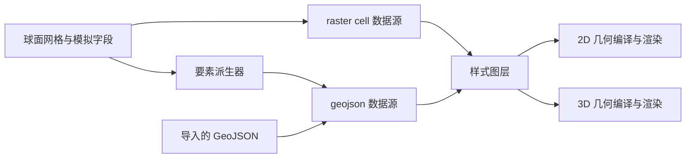

# 渲染数据源与图层架构设计

> 状态：基础架构已按下文顺序接入 2D／3D 视图。本文同时保留设计约束与后续边界问题。

## 目标与边界

项目只定义两种地理数据源格式：**`raster`（球面 cell 字段）**与 **`geojson`（点、线、面要素）**。数据源描述“有什么数据”，样式图层描述“选择哪些数据、何时可见、如何绘制”，2D 与 3D 渲染器负责把同一份地理数据变成各自的显示几何。

球面网格及模拟输出的 `TypedArray` 仍是生成世界的权威真源。GeoJSON 可以来自外部导入，也可以由模拟数据派生。把模拟结果转换为 GeoJSON 不应反向改变模拟结果，更不应在每一帧重复生成要素对象。云、大气和光照等视图特效不强制伪装为地理数据源。



## 两种数据源

| 数据源类型 | 数据内容 | 适合的图层 |
| --- | --- | --- |
| `raster` | 与球面 cell 索引对齐的连续值、类别值及掩码，保留 `TypedArray` | 卫星影像、温度、降水、高程、人口密度、市场可达性等 |
| `geojson` | `FeatureCollection`，要素具有稳定的 `id`、地理坐标 `geometry` 和可序列化的 `properties` | 聚落、圣地、道路、河流、国界、国家／民族／宗教区域等 |

这里的 `raster` 是**按球面 cell 采样的字段**，不是必须先生成的二维图片。cell 是不规则的球面 Voronoi 网格；数据源要持有或引用相应网格版本，字段长度必须与 cell 数一致。连续字段可做色带映射和插值；分类字段默认按类别取色，不跨类别插值。缺测值、海陆掩码、字段单位和时间索引应作为数据源元数据表达，而不靠颜色值推断。

GeoJSON 使用经纬度坐标，`Point`／`MultiPoint`、`LineString`／`MultiLineString`、`Polygon`／`MultiPolygon` 分别承载点、线、面。要素 `id` 在同一数据源内稳定且唯一，供拾取、筛选、编辑及导出使用。`properties` 存放名称、等级、人口、归属、强度等数据；颜色、文字尺寸和缩放规则属于样式图层。文本的逐字位置、Three.js 矩阵、投影坐标与 GPU 缓冲区属于布局或渲染缓存，不写入 GeoJSON。

对导入的 GeoJSON，应检查坐标范围、要素 ID、几何类型、多边形环闭合及洞的有效性。默认将要素贴附地表；如果以后支持高度值，需要单独规定高度单位和贴地方式，以免把模拟高程与视觉夸张位移混用。

### 生成型 GeoJSON

- 聚落与圣地由模拟实体生成点要素；一个点源可同时供图标、名称和拾取使用。
- 道路、航线和河网由模拟路径生成线要素。宽度、颜色、虚线和等级由样式控制。
- 国家、民族、语言、宗教等分类区域，先按 cell 归属值合并相邻单元，再从共享 Voronoi 边提取边界环，生成 `Polygon` 或 `MultiPolygon`。同一实体可以包含飞地、岛屿和孔洞。
- 国界线应从同一份区域拓扑派生，保证边界描线与区域填充一致；争议状态等边属性可以保留在派生线要素中。

生成型区域的原始边界和平滑边界共享实体 ID 与属性，仅几何版本不同。平滑时要同时约束相邻区域的共享边，固定多区域交汇点，不能独立平滑每个多边形而造成裂缝。类别归属依旧来自 cell 字段。

## 数据源与渲染器的兼容关系

| 数据源／几何 | 渲染器 | 说明 |
| --- | --- | --- |
| `raster` cell 字段 | `raster` | 分类着色、连续色带、掩码及透明度 |
| GeoJSON 点 | `symbol`、`circle` | 图标、文字或简单点标记；聚落默认用图标 |
| GeoJSON 线 | `line`、`symbol` | 描线或沿线文字 |
| GeoJSON 面 | `fill`、`line`、`symbol` | 区域填充、轮廓和区域名称 |

“数据源类型”和“渲染器类型”是两个独立字段。同一数据源可以被多个样式图层引用，例如聚落点同时提供图标和名称，国家面同时提供填充与区域名称。图层的先后顺序、`minZoom`／`maxZoom`、视图限制、筛选表达式、布局和绘制属性继续由样式文档定义。`get` 表达式读取 GeoJSON `properties`，或在 `raster` 图层中读取当前 cell 的字段值。

样式预设应保持为纯 JSON 可序列化的配置。预设中的数据源描述只引用运行时提供者或导入资源，不内嵌大型 `TypedArray` 或整个世界的 GeoJSON。示意结构如下，字段名称为设计草案：

```json
{
  "sources": {
    "temperature": { "type": "raster", "grid": "world-cells", "provider": "climate.temperature" },
    "polityAreas": { "type": "geojson", "provider": "generated:polity-areas" },
    "settlements": { "type": "geojson", "provider": "generated:settlements" }
  },
  "layers": [
    { "id": "temperature", "source": "temperature", "renderer": "raster", "paint": { "raster-color": ["interpolate", ["linear"], ["get", "temperature"], -20, "#4A72B5", 40, "#D95B36"] } },
    { "id": "polities", "source": "polityAreas", "renderer": "fill", "layout": { "boundary-mode": "smoothed" }, "paint": { "fill-color": ["match", ["get", "groupId"], 0, "#B8D8A0", 1, "#E4BD92", "#C5C5C5"] } },
    { "id": "cities", "source": "settlements", "renderer": "symbol", "layout": { "text-field": ["get", "name"] } }
  ]
}
```

`boundary-mode` 控制区域几何预处理，取原始或平滑边界；它不改变源中的类别值。`raster` 的插值控制数值／颜色过渡，与区域边界平滑是不同操作。

## 面图层与强度字段

Light、Dark、Standard 制图底图使用由 `world-surface.isLand` 派生的 `land-areas` GeoJSON 面。海岸线由共享 Voronoi 边界提取并平滑；2D 以海洋背景色和陆地面显示，3D 以单色海洋球体和陆地面显示。三个预设各自只有一种陆地颜色和一种海洋颜色，均不按高程着色。生成型陆地面的内部三角剖分复用原网格顶点，以保证大型陆块、岛屿及内湖的覆盖；对外仍提供平滑的 Polygon／MultiPolygon 数据。导入型 `land-areas` 则走通用 GeoJSON 面三角化流程。

卫星影像、气温和降水等 raster 模式仍把 cell 合并到一个几何体中；这**不是每个 cell 一次绘制调用**。民族、语言、国家和宗教的类别颜色只由生成型 GeoJSON 面图层绘制，基础地表不再按这些类别着色。四类内置面图层统一读取平滑后的区域坐标，国界描线也使用对应的平滑角点；原始边界仍可通过数据源的 `raw` 模式导出。`fill` 渲染器根据多边形边界、孔洞和离散部分构建整块区域的填充网格；凹多边形不能简单使用中心点扇形剖分。

整块分类面适合表示“谁属于哪里”。国家控制强度、民族占比或宗教份额如果在同一区域内部逐 cell 变化，单个纯色多边形无法保留这些细节。此时使用同一模拟字段的 `raster` 图层叠加表达强度，或采用区域级汇总值为 `fill` 着色。不要为了把连续字段塞进 GeoJSON 而为每个 cell 创建一个面要素。

## 双视图编译、缓存和交互

数据源保持视图无关。2D 编译器处理投影、中央经线、跨日期变更线的展开与裁剪、地图水平循环；3D 编译器处理球面贴附、地形位移、大面积多边形细分和背面遮挡。多边形外环与洞必须一同三角化，且要防止大跨度球面三角形穿入球体。文字锚点和曲线排版在渲染布局阶段计算。

缓存分为三个层次：

1. **数据缓存**：模拟版本或导入资源版本决定 cell 字段、生成型 GeoJSON 何时失效。
2. **几何缓存**：数据版本、原始／平滑边界、投影参数和 2D／3D 视图决定何时重新编译缓冲区。
3. **样式缓存**：缩放、筛选、颜色及透明度变化优先更新可见性、材质或颜色缓冲区，避免重算地理边界。

GeoJSON 是交换与编辑接口，不是逐帧渲染格式。编译后使用批量 GPU 缓冲区，并保留缓冲区元素到 `sourceId`／`feature.id` 的映射以供拾取。渲染器复用现有点、线、文字批量化思路；区域面是否更省三角形应以实际网格密度、球面细分和 GPU 统计判断，不能仅凭“整块面”推断性能提升。

## 导入、导出与编辑语义

- GeoJSON 图层可以直接导入、验证和导出。导出生成型要素时，要记录使用的模拟版本及原始／平滑几何版本。
- `raster` cell 字段导入导出时需要网格标识、字段类型、单位和缺测值约定；不能直接把 `TypedArray` 当作标准 GeoJSON 导出。不同网格之间导入需要明确重采样规则。
- 导入型 GeoJSON 要素可按稳定 ID 修改几何和属性，并使相应数据、几何和样式缓存失效。
- 生成型 GeoJSON 是模拟字段的派生结果。修改其边界不会自动改变 cell 归属；未来若允许编辑国家等区域，应明确选择“写回 cell 归属”或“保存独立覆盖图层”，并据此处理邻接关系与共享边。

## 落地顺序与代码位置

1. [`data-sources.ts`](../src/core/data-source/data-sources.ts)、[`geojson.ts`](../src/core/data-source/geojson.ts) 定义两种运行时数据源、网格标识、GeoJSON 校验、修订号与导入导出；[`source-registry.ts`](../src/core/data-source/source-registry.ts) 只登记 `raster`／`geojson`，样式校验检查几何类型与渲染器兼容性。
2. Light、Dark、Standard 制图底图使用 `land-areas` 的平滑矢量面和样式中的单色 `fill-color`；海洋使用同一预设的 `ocean` 颜色。自定义 raster 图层仍可为指定底图模式着色。卫星、高程、气候等原有 `WorldColorizer` 分支继续提供默认色带与特效。导入 raster 时要求 `gridId` 与当前球面网格匹配。
3. 聚落、圣地、文字锚点、交通、国界与河网均有 GeoJSON 数据源。点、普通线与文字采用共享的 2D／3D 图层；河流继续使用带宽度的 ribbon 几何，但其输入已改为 GeoJSON 线要素，不再直接从模拟字段绘制。
4. [`geojson-area-sources.ts`](../src/core/data-source/geojson-area-sources.ts) 从共享拓扑派生国家、民族、语言、宗教的原始／平滑多边形。[`styled-fill-layer.ts`](../src/core/rendering/shared/styled-fill-layer.ts) 三角化包含洞与飞地的 GeoJSON 面，并在 2D／3D 共用样式接口。国界与国家面取相同的 Voronoi 角点集合。
5. 导入型 GeoJSON 可以按稳定 ID 更新；图层订阅数据源变化后重建几何。点、线、面、文字图层均可返回 `{ layerId, sourceId, featureId }`，视图通过 `pickGeoJsonFeature` 暴露该结果。生成型 GeoJSON 可导出；旧的直接返回 `BufferGeometry` 的线源适配器已移除。

新增普通 GeoJSON 点／线／面图层时，先导入 `FeatureCollection` 或注册生成型数据源，再在样式文档中声明 `sources` 与 `layers`。新增 cell 字段图层时，导入与当前网格一致的 raster 源，并用 `baseMaps` 关联现有底图模式。

当前边界：面图层先将球面 GeoJSON 裁剪到六个局部投影片，再处理洞、三角化和球面细分，避免经纬度平面在日期变更线与极区产生大跨度填充。极复杂或自交的外部多边形仍需先做几何修复。河流的 ribbon 宽度和文字的曲线排版有专用几何布局，虽然输入数据与图层样式已统一。普通线仍使用 WebGL 原生线段，线宽受平台限制，`line-cap`／`line-join`／`line-dasharray` 尚未由通用线渲染器实现。现有卫星和气候色带仍由原色彩器提供；将所有默认色带都搬到样式文档属于后续工作。新增自定义底图模式还需在应用的底图列表中注册入口。
